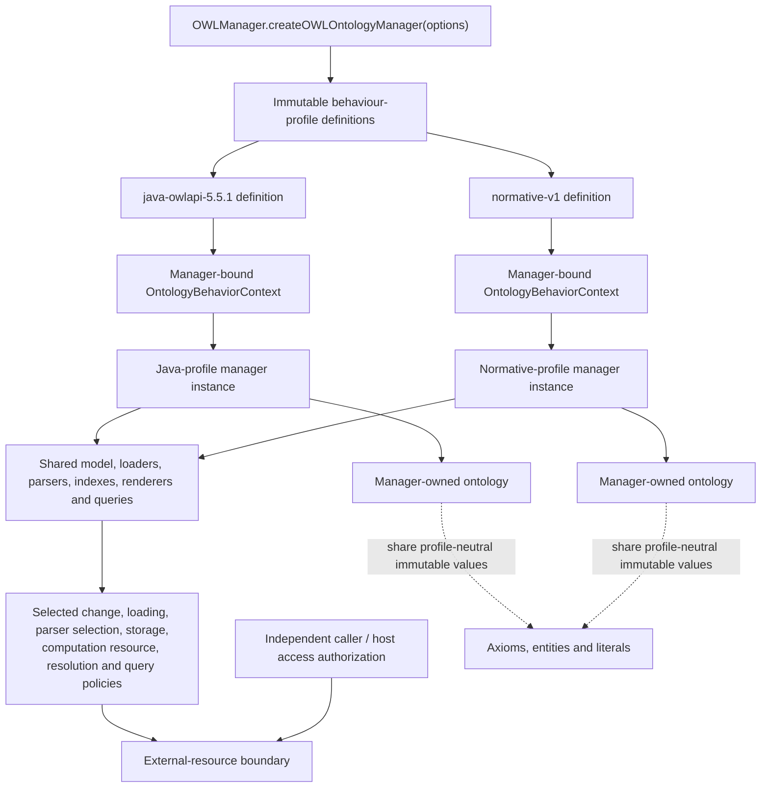
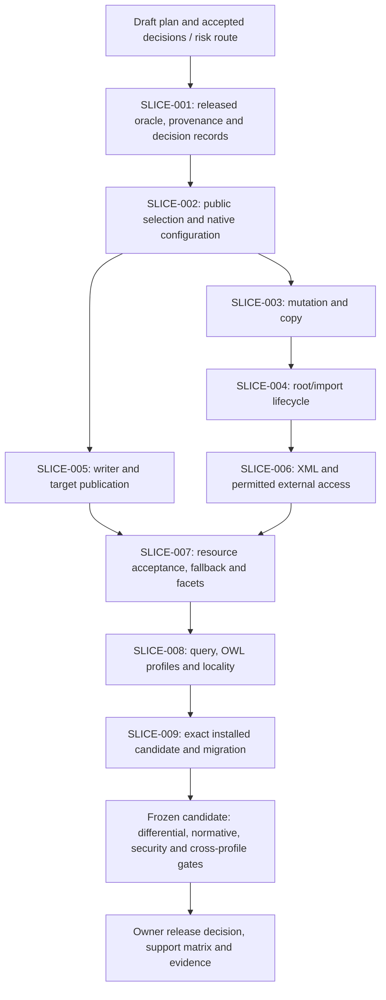

# Java-compatible API behaviour implementation plan

**File:** `docs/plans/2026-10-13-java-compatible-api-behavior-implementation-plan.md`\
**Date:** 2026-10-13\
**Status:** Draft HISEW revision; implementation and profile qualification pending\
**Profiles:** `java-owlapi-5.5.1`, `normative-v1`\
**Java oracle release:** OWLAPI 5.5.1\
**Java source commit:** `f760b3a4c107c6d5f90f856e5680c39b18af646f`\
**Java source tree:** `6b87391a36b7341f7253f57046b5b8621d3d0ac8`\
**Release tag:** `owlapi-parent-5.5.1`

This revision preserves the two-profile design and technical worklist in commit `3e68d03c8061dbfd7604984e3f26d3b8b2defc9d`, and makes its requirements, naming, TDD, ownership and delivery gates explicit.
The design conversation is retained as context [design-chat]; this document is the reviewable draft, not evidence that all consequential decisions have been accepted or implemented.
Historical research, probes, baselines and completed implementation evidence remain evidence of what was observed at the time; they do not retain authority where this plan deliberately changes the target contract.

## Executive summary

The project will implement **one OWLAPI JavaScript codebase with two immutable, explicitly versioned behavioural profiles**:

| Profile             | Purpose                                           | Governing question                                                                                                    |
| ------------------- | ------------------------------------------------- | --------------------------------------------------------------------------------------------------------------------- |
| `java-owlapi-5.5.1` | Exact migration and behavioural-emulation profile | “What does the official Java OWLAPI 5.5.1 release actually do?”                                                       |
| `normative-v1`      | Standards- and contract-governed profile          | “What behaviour is required by applicable normative specifications and the project's formally adopted API contracts?” |

This replaces the previous premise that every observable Java quirk should become the single JavaScript behaviour.
The earlier implementation plan explicitly targeted Java-observed sequential change effects, retained manager/import state after failures, StringDocumentTarget accumulation and other quirks. The underlying research remains highly valuable, but those observations now become **profile inputs rather than universal requirements**. The existing evidence records, for example, Java-style thrown partial effects during change application, retained import/configuration state, StringDocumentTarget reuse behaviour, parser-fallback differences and lazy/live query behaviour. [research-primary] [research-gaps] The Java compatibility baseline is no longer an arbitrary source revision.
It is the formal OWLAPI **5.5.1 release**.
Maven Central publishes `net.sourceforge.owlapi:owlapi-distribution:5.5.1`; the upstream release commit is `f760b3a4c107c6d5f90f856e5680c39b18af646f`; the annotated tag `owlapi-parent-5.5.1` points through tag object `8003508e8c185579898ca4eda1245f808461d06a` to that exact commit.
The commit message is `OWLAPI version 5.5.1`, and the release commit changes the project from `5.5.1-SNAPSHOT` to `5.5.1`. [java-pom] [java-tag] [java-commit] The profile architecture is **policy separation, not implementation duplication**.
A manager receives one immutable behavioural context at construction.
Loading, parsing, mutation, storage, security/resource handling and profile-sensitive utilities receive that context explicitly.
Model values remain profile-neutral wherever behaviour does not depend on a profile.
There is no global mode, no mutable profile switch, no “latest Java” alias and no arbitrary combination of independent compatibility flags.

The governing hierarchy for `normative-v1` is:

1. applicable **normative external specifications** and published errata;
2. explicit, versioned **project contracts**, including security and engineering guarantees adopted from referenceable principles;
3. Java OWLAPI 5.5.1 behaviour as the **compatibility fallback** where the first two levels do not prescribe a different observable result.

The hierarchy deliberately distinguishes a normative specification from any document colloquially called a “spec”.
OWL 2 Structural Specification and Functional-Style Syntax is a W3C Recommendation whose normative structural rules explicitly govern observable OWL-tool behaviour.
By contrast, OWL 2 Manchester Syntax is a W3C Working Group Note and expressly states that publication does not imply W3C endorsement. [owl-structure] [manchester-note] That distinction corrects an important example discussed during design.
OWLAPI 5.5.1 maps the Manchester token `<=` to `xsd:maxInclusive`. [java-facets] The Manchester Working Group Note's mapping table instead says `<=` maps to `xsd:minInclusive`. [manchester-note] But the normative OWL 2 Structural Recommendation defines `xsd:minInclusive` as the lower-bound relation \(x \ge v\) and `xsd:maxInclusive` as the upper-bound relation \(x \le v\). [owl-structure] Consequently **`normative-v1` must not blindly reproduce the Working Group Note's table merely because it is a W3C document**.
Under the hierarchy proposed here, the Recommendation outranks the non-endorsed Note; a project contract cannot override an applicable higher-ranked normative requirement.
The Manchester token mapping must be adopted explicitly from the compatible Java/source evidence: both profiles should retain `<= → xsd:maxInclusive`, with greater-than counterparts checked together (DEC-003).
This example is the model for future authority resolution.

The implementation therefore has two complementary promises:

> **`java-owlapi-5.5.1` is an emulation contract. `normative-v1` is a conformance-and-contract contract.**

Neither is “the real implementation” with the other treated as a compatibility shim.
Both are first-class test subjects over the same shared implementation.

Release qualification requires three independent forms of proof: differential regression against the exact Java oracle for `java-owlapi-5.5.1`; specification, invariant and fault-injection testing for `normative-v1`; and cross-profile tests proving both deliberate differences and deliberate common behaviour.

## HISEW baseline, requirements and decisions

### Purpose, status and governing method

The higher outcome is a dependable migration path: on the selected matched API surface, a Java OWLAPI user selecting `java-owlapi-5.5.1` receives the same observable behaviour, configuration methods and defaults under equivalent declared host conditions.
Equality includes accepted inputs, failure timing, partial effects and resource rejection; equal successful output alone is insufficient.
The separate `normative-v1` contract makes explicitly adopted differences available without changing the Java profile.

This is a draft revision of the committed plan, not implementation authority or a completed qualification report.
The [design conversation][design-chat] supports the two-profile direction.
Its individual recommendations, this plan's proposed public names, normative defaults and stronger guarantees still require the decision records below before their dependent implementation.
Rewriting this document does not reset any earlier human approval, but an approval must identify the scope and version it actually covered.

The review uses HISEW `hisew-dev 0.1.0-dev.21`, its [planning procedure][hisew-planning] and [engineering principles][hisew-principles].
The locally inspected planning skill has SHA-256 `3b3b770b060acdbce7725fea2a660b34cf575f0a80e08244e8fb66e5145a2d35`; the principles document has SHA-256 `777ad41e148d5b4378a7b5960fecfcc3ea1471e046cec5a697fda2b59712f261`.
The links are navigational references to maintained sources; these version/digest observations identify the instructions used for this review.
Active personal workflow applicability was checked for this worktree.
No new workflow execution, implementation, release or retrospective approval is claimed.

The proposed implementation risk route is **R2**, because this changes public API contracts, input acceptance, parser and network boundaries, re-entrant state and installed-package behaviour.
The repository owner accepts the route and design baseline before implementation.
A concrete critical-system, privileged-host or irreversible-data consequence would trigger a new risk assessment; the presence of XML or HTTP alone does not automatically justify R3.
This document-only revision does not run the future implementation gates.

### Review findings and disposition

| HISEW concern               | Finding in the incoming plan                                                                                                                                          | Required correction in this revision                                                                                               |
| --------------------------- | --------------------------------------------------------------------------------------------------------------------------------------------------------------------- | ---------------------------------------------------------------------------------------------------------------------------------- |
| NAM-01                      | `profile` could mean a behavioural profile, an OWL language profile or an identifier; `sha`, `qualifiedAt` and signature booleans obscured identity or evidence state | Use the terminology and field contracts below; distinguish identity, definition, evidence, authorization and qualification state   |
| DRY-01                      | Prohibition of duplicated algorithms did not establish the owner of each shared rule or allow independent oracles                                                     | Record current authorities, consumers, reasons for change, deliberate separation and drift tests                                   |
| Requirements and acceptance | No stable REQ/AC/QA/DEC-to-slice chain; several proposed contracts read as already accepted                                                                           | Add the draft dossier and acceptance decisions; implementation may not manufacture acceptance                                      |
| TDD                         | Comprehensive end-state tests, but no red–green–refactor delivery method                                                                                              | Make each slice begin with independent failing behavioural proof and finish with refactoring plus affected regression evidence     |
| Vertical delivery           | Timeline separated architecture, implementation and testing into broad phases                                                                                         | Deliver thin observable paths with their contract, implementation, tests and owning documentation together                         |
| Security and compatibility  | External-resource behaviour and permission were conflated                                                                                                             | Separate the behaviour a profile specifies from resources a caller/host permits; qualify Java under explicitly matched permissions |
| Provenance                  | Placeholder strings had the wrong types; `false` could mean unsigned or unverified; dependency closures were asserted before proof                                    | Use typed draft state, explicit verification outcomes, measured locks and qualification guards                                     |
| Evidence and migration      | Chat-only citations were unresolved; support and freeze wording preceded evidence                                                                                     | Replace citations with portable references, preserve historical digests, and label target support/freeze states as future gates    |

### Draft requirements and acceptance criteria

All IDs are stable plan identifiers.
Requirement acceptance belongs to the repository/product owner; measurements belong to the relevant slice's evidence owner.
The selected API inventory must be frozen by DEC-001, not inferred from the phrase “Java compatible”.

| Requirement | Required outcome                                                                                     | Acceptance criterion                                                                                                                                                                                                                               |
| ----------- | ---------------------------------------------------------------------------------------------------- | -------------------------------------------------------------------------------------------------------------------------------------------------------------------------------------------------------------------------------------------------- |
| REQ-001     | Exact Java compatibility on the selected released surface and declared host boundary                 | AC-001: every selected member has a 5.5.1 observable vector; zero unmatched differences in accepted input, output, error, phase, side effects, order, lazy consumption, storage or resource attempts                                               |
| REQ-002     | Two immutable, explicitly versioned behaviour profiles in one codebase                               | AC-002: construction and read-only identity work for both profiles; no global switching, mutation setter, mutable latest alias or undeclared hybrid; asynchronous and lazy paths retain the initiating identity                                    |
| REQ-003     | Normative changes have an applicable, accepted authority and falsifiable guarantee                   | AC-003: each split/one-sided row cites clauses or an accepted project contract, states preconditions and success/failure invariants, and has paired proof; zero unclassified rows                                                                  |
| REQ-004     | Java configuration methods, types, defaults, copy/reset semantics and read timing match Java         | AC-004: a setter/getter/identity/timing matrix passes the released oracle, including zero, negative and no-op cases; no JS-only finite default changes the Java profile's accepted input                                                           |
| REQ-005     | Correct manager ownership and profile propagation                                                    | AC-005: source ownership survives copy, destination collision fails before publication, misuse is classified, and concurrent/re-entrant operations have tested profile-specific effects                                                            |
| REQ-006     | Profile-specific mutation and loading failure guarantees                                             | AC-006: Java partial-state vectors match; normative failure preserves the stated ontology/index/import/configuration boundary at every meaningful injected failure point                                                                           |
| REQ-007     | Profile-specific target reuse and save-failure semantics                                             | AC-007: repeat-save and renderer-failure tests cover all exposed formats; Java bytes match, normative replacement publishes once and failed save preserves the old text                                                                            |
| REQ-008     | Resource exhaustion is distinct from semantic invalidity                                             | AC-008: all cap owners and consumers are inventoried; below/at/above tests and large valid fixtures prove Java-compatible acceptance and explicit normative budgets, units and failure categories                                                  |
| REQ-009     | XML, remote imports and JSON-LD respect declared behaviour and independent access authority          | AC-009: owned-server/file-fixture tests prove request/redirect/cache/credential and XXE outcomes for matched allowed and denied capabilities, with no cross-manager or cross-profile permission leakage                                            |
| REQ-010     | Parser selection, structural mappings, lazy search, providers and locality have classified contracts | AC-010: fallback/error chains, Manchester facets, callback/order/live-view and empty-seed/locality probes pass their authority-specific and shared vectors                                                                                         |
| REQ-011     | Release oracle and installed-package proof are reproducible and attributable                         | AC-011: tag/commit/tree, Central POM/JAR, complete dependency/toolchain locks, source comparison and fixture/observation digests pass the provenance gates; both profiles pass from the exact package bytes                                        |
| REQ-012     | Material names are semantically correct and shared knowledge has one owner                           | AC-012: field/name audit resolves each ambiguity, Java-mandated names are preserved, affected consumers and schemas agree, and DRY decisions identify separate or shared authority with drift checks                                               |
| REQ-013     | Migration, versioning, support, abort and recovery are explicit                                      | AC-013: documentation identifies the omission default, exact Java opt-in, host boundary, accepted differences, support state and recovery route; no historic record or existing profile identity is retargeted                                     |
| REQ-014     | Delivery is test-first, traceable and evidence-driven                                                | AC-014: every slice records an observed meaningful red, minimum green, refactor check and affected regressions; the frozen candidate passes the applicable HISEW route with independent review and evidence reuse assessed against measured inputs |

### Quality scenarios

Each scenario states source, stimulus, environment, affected artefact, response and measurable acceptance.
Performance observations characterize cost; they do not authorize inventing Java-incompatible rejection limits.

| Scenario | Source and stimulus                                                                      | Environment and artefact                                                                   | Required response                                                                                                                  | Measure and trace                                                                                                                                  |
| -------- | ---------------------------------------------------------------------------------------- | ------------------------------------------------------------------------------------------ | ---------------------------------------------------------------------------------------------------------------------------------- | -------------------------------------------------------------------------------------------------------------------------------------------------- |
| QA-001   | Migrating caller supplies a valid structure above a former JS-only ceiling               | Both profiles; source and installed package; data factory, parser, storage and query paths | Java accepts whenever the qualified oracle accepts; normative uses its explicitly adopted policy and reports exhaustion separately | Boundary `n-1/n/n+1` where finite plus an oracle-accepted large fixture; zero unexplained rejection; AC-001, AC-008                                |
| QA-002   | A dependency or injected stage fails during mutation, root load, copy or save            | Manager already contains observable state; every meaningful publication boundary           | Java exposes the oracle's effects; normative preserves exactly the promised in-memory state                                        | State-vector equality before/after normative failure, exact Java vector, successful retry and no orphan ownership; AC-005–AC-007                   |
| QA-003   | Untrusted XML/context/import requests local or remote resources or redirects credentials | Controlled files and owned HTTP servers; permitted and denied host policies                | No request exceeds caller/host authorization; profile-specific attempts, failure phase and diagnostics are classified              | Exact event trace, zero prohibited file/network access and credential forwarding; AC-009                                                           |
| QA-004   | Two callers interleave loads/writes or consume a lazy result after mutation              | Two managers with different behaviour profiles; asynchronous and re-entrant paths          | Original context remains bound; normative publication is atomic at its declared point or overlap is rejected                       | Controlled schedules and callback order/count match expected vectors; zero cross-context effects; AC-002, AC-005, AC-010                           |
| QA-005   | Release engineer rebuilds and reruns the Java oracle                                     | Isolated dependency cache; pinned source, JDK, Maven and ordered classpaths                | All resolved bytes are accounted for; Central/source observations are compared without modifying upstream code                     | Zero unexpected dependency resolution; complete digests; byte non-identity explained; semantic non-identity blocks qualification; AC-011           |
| QA-006   | Consumer installs the exact candidate and selects each profile                           | Supported Node and browser lanes with capability matrix                                    | Public signatures, defaults and behaviour match the contract without source-tree imports                                           | Exact package digest and environment recorded; every selected lane passes or is explicitly excluded from the support claim; AC-004, AC-011, AC-013 |
| QA-007   | Maintainer changes a field, shared rule or profile decision                              | Production code, schema, ledger, documentation and independent tests                       | One term denotes one concept; consumers follow one current authority; oracle expectations remain independent                       | Naming/schema checks and relevant conformance tests detect a deliberate representative mismatch; AC-012, AC-014                                    |
| QA-008   | Delivery is interrupted or a post-release regression is found                            | Partial slice, frozen candidate or published package                                       | Resume from recorded identity; stale evidence is not relabelled; observer aborts promotion or performs the agreed recovery         | Recovery rehearsal identifies remaining effects, owner and exact package/contract version; no promise to undo external requests; AC-013, AC-014    |

### Decisions and acceptance boundaries

“Carried forward” means retained from the incoming plan, not newly approved by this rewrite.
No open decision is resolved by choosing whichever implementation is easiest.

| Decision | Proposed or established direction                                                                                               | Status and owner                                                                                                                              | Minimum evidence / stop condition                                                                                                                                         |
| -------- | ------------------------------------------------------------------------------------------------------------------------------- | --------------------------------------------------------------------------------------------------------------------------------------------- | ------------------------------------------------------------------------------------------------------------------------------------------------------------------------- |
| DEC-001  | Two immutable profiles, released Java 5.5.1 baseline and exact selected public surface; implementation route R2                 | Two-profile direction supported by the design chat; repository owner must accept the implementation baseline, member inventory and risk route | Reconcile current capability/parity inventories and identify supported hosts; an unlisted public API or release-target change requires re-baselining                      |
| DEC-002  | Omitted `behaviorProfileId` selects `normative-v1`; Java migrations select `java-owlapi-5.5.1` explicitly                       | Carried-forward public default; owner acceptance must be attached before SLICE-002                                                            | Installed-consumer impact and migration examples; this default cannot be described as automatic Java migration equivalence                                                |
| DEC-003  | Normative authority hierarchy, facet adjudication and project contracts for atomicity, replacement, fallback and configuration  | Carried-forward proposal; repository owner accepts each consequential contract                                                                | Applicable normative clauses/errata, exact Java observation and paired pre/postconditions; conflicts remain blocked for the affected slice                                |
| DEC-004  | Independent access authorization and profile-specific resource/transport semantics                                              | Clarification supported by the earlier chat research; repository owner and security reviewer confirm the resulting public/host boundary       | Allowed/denied capability matrix, exact Java settings and no hidden JS-default restriction; policy that narrows the claimed Java surface requires explicit scope decision |
| DEC-005  | One authoritative owner for common knowledge; narrow separate rules for real profile differences                                | Architectural direction; implementation owner records material DRY choices, reviewer validates                                                | Current owner/consumer inventory and tests; oracle/implementation independence cannot be abstracted away                                                                  |
| DEC-006  | Precise proposed names and typed evidence contracts in this revision                                                            | Naming proposal; owner/API reviewer accepts new public extension names; NAM-01 correctness is mandatory                                       | Verify identifiers are unshipped, check existing schema consumers, preserve Java-required names; no compatibility alias is authorized                                     |
| DEC-007  | Central artefact is executable oracle; source build corroborates; complete locks and explicit trust state                       | Carried-forward provenance contract; qualification owner provides evidence                                                                    | All provenance gates and Central/source behavioural comparison; unsigned identity is not signed trust and placeholders cannot qualify                                     |
| DEC-008  | Preserve manager ownership; cross-manager operation described here is a copy; normative protected-state boundaries are explicit | Carried-forward semantics with terminology corrected; Java ownership behaviour still requires oracle confirmation                             | Conflict between Java-observed ownership and the proposed invariant stops the affected design; never silently impose a new Java rejection                                 |
| DEC-009  | Reuse existing parser/storage/model/toolchain/harness facilities and independently validate actual consumers                    | Reuse direction; residual new capability selection and licence clearance remain prerequisites                                                 | REU-01/VER-01/LIC-01 evidence for the actual dependency/source reuse; no claim that this document completes deep selection or rights review                               |
| DEC-010  | Profile/version support and release promotion follow evidence, with an explicit observer and recovery route                     | Carried-forward lifecycle; repository owner assigns release observer and approves promotion when qualified                                    | Exact candidate, route-selected checks, migration acceptance and recovery rehearsal; publication is outside this rewrite                                                  |

The linked chat also discussed inserting documented Java public contracts above observed Java behaviour in the normative fallback hierarchy.
This incoming plan instead falls back directly to the released observation.
That difference is recorded for DEC-003: Javadoc is supporting contract evidence, not a silently inserted new precedence rank.
If the distinction changes an outcome, reconcile and accept the rank before implementation.
The Java emulation profile always targets actual qualified behaviour.

## Scope and objectives

The implementation covers the selected Java-shaped public OWLAPI surface already represented by the repository's compatibility programme: manager construction and lifecycle, ontology loading and imports, parser selection, configuration, ontology changes, selected searches/providers/locality operations, OWL language profile evaluation and the currently exposed StringDocumentTarget storage routes.
The existing public factory already accepts an optional options object and constructs `OWLOntologyManager`, making behavioural-profile selection an extension of the existing API shape rather than a second public hierarchy. [manager-factory] The public documentation likewise describes the call as `OWLManager.createOWLOntologyManager(options?)`. [public-api] The replacement plan has the following objectives.

| Objective                              | Required outcome                                                                                                                                                                    |
| -------------------------------------- | ----------------------------------------------------------------------------------------------------------------------------------------------------------------------------------- |
| One implementation                     | Common model, parser infrastructure, indexes, renderers and transport abstractions; no forked “Java” and “normative” packages                                                       |
| Explicit behavioural contracts         | Every profile-sensitive observable is assigned to `java-owlapi-5.5.1`, `normative-v1`, or shared behaviour                                                                          |
| Formal Java provenance                 | Java oracle derives from the released OWLAPI 5.5.1 tag, published artefacts and locked effective dependency graph                                                                   |
| Immutable profile identity             | A manager's behavioural profile cannot change after construction                                                                                                                    |
| Standards discipline                   | “Normative” means normative specifications plus deliberately adopted contracts, not a generic preference for cleaner behaviour                                                      |
| Strong failure contracts where adopted | Operations designated transactional by `normative-v1` satisfy their stated commit-or-rollback invariant                                                                             |
| Secure external-resource handling      | `normative-v1` uses explicit policy for XML external resources and network dereferencing; Java compatibility reproduces Java behaviour within the declared host-capability boundary |
| Verifiable intentional divergence      | Every profile difference has a source, rationale, expected observable vector and paired test                                                                                        |
| Stable version semantics               | Existing profile identifiers never silently acquire new behaviour                                                                                                                   |
| Migration clarity                      | Consumers can choose exact Java emulation or the normative contract without learning hidden switches                                                                                |

**In scope.**
Structural and semantic output corrections are now governed by the same authority hierarchy rather than being categorically outside behavioural compatibility.
A Java/specification difference may therefore be intentionally split between profiles, but only after the specification's status, applicable normative clauses, errata and scope have been established.

**Out of scope.**
This plan does not require implementing every missing Java class or overload; ambient JVM facilities that have no JavaScript-host analogue; a second parser stack; a second ontology model; a global Java-emulation environment; arbitrary feature-flag combinations; or automatic compatibility with unreleased/future Java revisions.
Missing host capabilities must be reported as capability boundaries rather than silently approximated.

The old source pin `b61ebe2da83daceebb3e7ba7afbd2582c9240c33` is superseded for oracle qualification.
Existing probes produced against that revision may seed the new suite, but none constitutes final `java-owlapi-5.5.1` proof until rerun against the release artefacts.
The previous plan explicitly recorded the earlier arbitrary source pin, so this is a deliberate baseline change rather than a reinterpretation of existing evidence. [research-primary] The portable [primary probe evidence][research-evidence] and [gap-closure probe evidence][research-gap-evidence] retain the observations and source references behind the reports.
The nine previously evaluated divergence areas remain the minimum behavioural worklist.
The research already establishes concrete observations in those areas, including Java partial change effects, retained manager state, private JavaScript resource ceilings, StringDocumentTarget reuse, JSON-LD boundaries and lazy/live search behaviour. [research-primary] [research-gaps] Completion of this plan requires **zero unclassified observable divergences on the selected surface**.
“Unclassified” means that a difference cannot be traced to one of: shared behaviour, an exact Java-profile expectation, or an explicit `normative-v1` authority decision.

## Authority and profile contracts

The authority model is intentionally asymmetric: `normative-v1` resolves conflicts using a hierarchy; `java-owlapi-5.5.1` intentionally preserves the released Java implementation even where a higher-level specification would produce a different answer.
Otherwise the Java profile would cease to be a faithful migration oracle.

**Authority hierarchy for `normative-v1`.**

| Rank          | Authority                                       | What qualifies                                                                                                    | What does not qualify                                                                                           |
| ------------- | ----------------------------------------------- | ----------------------------------------------------------------------------------------------------------------- | --------------------------------------------------------------------------------------------------------------- |
| Highest       | External normative specification                | Applicable normative clauses of W3C Recommendations or equivalent standards, including published normative errata | Examples, informative prose, Working Group Notes merely because they are on `w3.org`, implementation traditions |
| Next          | Adopted project contract                        | A versioned, explicit, testable OWLAPI-JS requirement with cited rationale and defined observable guarantee       | “Best practice”, “idiomatic JavaScript”, performance preference, aesthetic simplification                       |
| Fallback      | Java OWLAPI 5.5.1                               | Behaviour of the exact published oracle where higher authorities leave the question open                          | Behaviour from another Java version, an unreleased branch, inferred “likely Java behaviour”                     |
| Evidence only | Existing JS implementation and historical plans | Evidence of migration impact, prior design and existing consumers                                                 | Independent authority to override the three ranks above                                                         |

The OWL 2 Structural Specification is particularly strong authority because it explicitly says its structural model provides the normative abstract representation for OWL 2 and is used to specify observable behaviour of OWL 2 tools, while permitting implementations to use different internal structures so long as observable behaviour conforms. [owl-structure] This supports the architectural decision to share internal JavaScript mechanisms while varying only observable policy where required.

**Conflict-resolution procedure.**
Every proposed `normative-v1` difference must pass the following decision record before implementation:

| Field                     | Required decision                                                                                                                                              |
| ------------------------- | -------------------------------------------------------------------------------------------------------------------------------------------------------------- |
| Observable                | Define exactly what callers can distinguish: value, structure, accepted input, error category, failure phase, side effect, ordering, timing or external effect |
| External authority        | Identify the exact specification, status and applicable normative clause; check errata                                                                         |
| Contract authority        | If no external rule resolves it, identify the project contract and referenceable engineering/security rationale                                                |
| Java observation          | Record the exact 5.5.1 behaviour from independent oracle execution and, where useful, source inspection                                                        |
| Applicability             | Explain why the authority actually applies to this operation and not merely to a superficially similar problem                                                 |
| Guarantee                 | State preconditions, postconditions and failure guarantees in testable terms                                                                                   |
| Profile outcome           | `shared`, `profile-specific`, or—in a genuinely one-sided extension—`java-only`/`normative-only`                                                               |
| Proof                     | Identify oracle, conformance, invariant, fault-injection and cross-profile tests                                                                               |
| Compatibility consequence | State migration impact and security consequence                                                                                                                |
| Decision status           | Proposed, accepted, superseded or rejected; never infer acceptance from implementation                                                                         |

Check the [published OWL errata][owl-errata] alongside the exact specification revision.
If a normative external specification and an informative document disagree, the normative text wins.
If two applicable normative sources genuinely conflict, implementation must stop at the decision boundary until their scopes, revisions and errata are reconciled; arbitrary precedence by publication date is not permitted.
A non-normative source can influence `normative-v1` only after its relevant behaviour is deliberately adopted as a project contract.

Engineering principles therefore have **referenceable but bounded authority**.
The strong exception-safety guarantee is a useful model: it means an operation either completes or leaves the protected program state as it was before the operation—commit-or-rollback semantics.
Boost's canonical exception-safety exposition distinguishes this from the weaker basic guarantee, which preserves invariants but may permit state changes. [exception-guarantees] The project may adopt the strong guarantee for an operation, but the mere existence of that principle does not imply every OWLAPI operation must provide it.

Similarly, ACID provides the historical transaction vocabulary, but OWLAPI JavaScript must not casually claim database-level ACID semantics.
Härder and Reuter's transaction/recovery work concerns transaction-oriented database systems.
Here, **atomicity** is relevant by analogy to operations explicitly defined as transactional; durability and database isolation do not automatically follow. [transactions] Linearizability is narrower still.
Herlihy and Wing define it as a correctness condition for concurrent objects in which an operation appears to take effect at a point between invocation and response.
It should be applied only to stateful operations that can actually overlap or become observably interleaved—for example through asynchronous execution or re-entrancy—not as a decorative synonym for atomicity. [linearizability] Security authorities are also contractual inputs rather than OWL language semantics.
OWASP recommends disabling DTDs where possible and, where they are required, disabling external entity resolution/external DTD loading and limiting expansion; it identifies local-file disclosure, SSRF and resource exhaustion as XXE consequences. [xxe-guidance] OWASP's SSRF guidance additionally calls for destination-policy validation at connection time rather than relying solely on superficial URL validation. [ssrf-guidance] NIST SP 800-218 SSDF 1.1 remains the current final SSDF publication as of this plan; NIST lists SP 800-218 Rev. 1 / SSDF 1.2 as a draft rather than a final replacement. [ssdf-final] [ssdf-draft] These sources justify a secure-development and external-resource contract but do not themselves prescribe OWLAPI method signatures.

**Profile definitions.**

`java-owlapi-5.5.1` means:

> The observable behaviour of the official OWLAPI 5.5.1 release, running with the dependency/runtime configuration recorded in its provenance manifest, reproduced on the selected JavaScript public surface including observable implementation quirks and specification deviations.

Its canonical name is exactly `java-owlapi-5.5.1`.
There is no `java-owlapi-latest`, `java-compatible`, `java5`, SHA-derived public alias or mutable pointer.
A later Java release receives a different immutable profile identifier.

`normative-v1` means:

> The observable behaviour required by the normative specification set and explicit project contracts frozen into normative contract version 1, falling back to `java-owlapi-5.5.1` where those authorities do not prescribe a different result.

Its canonical name is exactly `normative-v1`.
A behaviourally significant change to that contract requires `normative-v2`; a documentation clarification that leaves all observable requirements unchanged does not.

The distinction is deliberately not “correct” versus “incorrect”.
A Java-compatible result may faithfully emulate a historical implementation quirk and therefore be correct under its own contract.
Conversely, a `normative-v1` change must not be justified merely as “better”.

**Default policy.**
Public documentation and all new project code must select a profile explicitly.
For compatibility with the existing optional-options call shape, omitted `behaviorProfileId` remains accepted in the first profile-aware release and resolves to `normative-v1`.
This carries forward the incoming plan's normative omission default (DEC-002).
It is a consequential product decision: migration instructions must select the Java profile explicitly, and the implementation must not describe an omitted selector as Java-compatible behaviour.
Changing that default later is itself a behavioural breaking change.
The current factory already supports an options object, so this choice does not require a parallel constructor family. [manager-factory] The proposed read-only identity method is:

```js
manager.getBehaviorProfileId();
// "normative-v1" or "java-owlapi-5.5.1"
```

There is no `setBehaviorProfileId()`.

## Provenance and reproducibility

The Java profile must be qualified against a **release artefact, source identity and complete dependency environment**, not merely a Git commit.
Qualification has not been completed by this document rewrite.

The upstream Git provenance is already sufficiently clear to freeze the source identity.
The Git reference `refs/tags/owlapi-parent-5.5.1` resolves to annotated tag object `8003508e8c185579898ca4eda1245f808461d06a`; that tag object targets commit `f760b3a4c107c6d5f90f856e5680c39b18af646f`. [java-tag] The target commit's tree is `6b87391a36b7341f7253f57046b5b8621d3d0ac8`, its message is `OWLAPI version 5.5.1`, and it records the 5.5.1 release changes. [java-commit] The raw Git objects inspected during this revision contain no commit or tag signature.
The manifest must distinguish unsigned objects from signatures that were not checked, could not be checked, or failed verification. [java-commit] [java-tag] Maven Central independently publishes the 5.5.1 distribution and related modules, providing a second release channel to bind into the oracle. [java-pom] The canonical provenance file shall be:

```text
docs/compatibility/profiles/java-owlapi-5.5.1/provenance.json
```

The resolved Java dependency lock shall be:

```text
docs/compatibility/profiles/java-owlapi-5.5.1/java-dependencies.lock.json
```

The following is the proposed **draft manifest data shape**, not a JSON Schema or a qualification result.
Known source identities are retained; unresolved measurements use `null` or an explicit status, never a string masquerading as a number or boolean.
SLICE-001 must add a schema and consumer validator using the repository's existing validation facilities.
A qualified instance has stricter conditional requirements than a draft.

```json
{
  "schemaVersion": 1,
  "behaviorProfileId": "java-owlapi-5.5.1",
  "qualification": {
    "status": "unqualified",
    "completedAt": null,
    "evidenceManifestPath": null
  },
  "upstream": {
    "repositoryUrl": "https://github.com/owlcs/owlapi",
    "releaseVersion": "5.5.1",
    "gitObjectFormat": "sha1",
    "tag": {
      "name": "owlapi-parent-5.5.1",
      "objectType": "tag",
      "tagObjectId": "8003508e8c185579898ca4eda1245f808461d06a",
      "peeledCommitObjectId": "f760b3a4c107c6d5f90f856e5680c39b18af646f",
      "taggedAt": "2024-09-08T13:30:53Z",
      "signature": {
        "verificationStatus": "unsigned",
        "signerFingerprint": null,
        "verificationEvidencePath": null
      }
    },
    "commit": {
      "commitObjectId": "f760b3a4c107c6d5f90f856e5680c39b18af646f",
      "treeObjectId": "6b87391a36b7341f7253f57046b5b8621d3d0ac8",
      "subject": "OWLAPI version 5.5.1",
      "committedAt": "2024-09-07T20:46:24Z",
      "signature": {
        "verificationStatus": "unsigned",
        "signerFingerprint": null,
        "verificationEvidencePath": null
      }
    }
  },
  "mavenCentral": {
    "repositoryUrl": "https://repo.maven.apache.org/maven2",
    "primaryCoordinate": {
      "groupId": "net.sourceforge.owlapi",
      "artifactId": "owlapi-distribution",
      "version": "5.5.1"
    },
    "artifacts": [
      {
        "groupId": "net.sourceforge.owlapi",
        "artifactId": "owlapi-distribution",
        "version": "5.5.1",
        "artifactType": "pom",
        "classifier": null,
        "byteLength": null,
        "sha256": null,
        "signature": {
          "verificationStatus": "not-checked",
          "signerFingerprint": null,
          "verificationEvidencePath": null,
          "signerTrustDecisionReference": null
        }
      },
      {
        "groupId": "net.sourceforge.owlapi",
        "artifactId": "owlapi-distribution",
        "version": "5.5.1",
        "artifactType": "jar",
        "classifier": null,
        "byteLength": null,
        "sha256": null,
        "signature": {
          "verificationStatus": "not-checked",
          "signerFingerprint": null,
          "verificationEvidencePath": null,
          "signerTrustDecisionReference": null
        }
      }
    ],
    "dependencyLock": {
      "path": "java-dependencies.lock.json",
      "sha256": null,
      "repositoryUrl": "https://repo.maven.apache.org/maven2",
      "oracleExecutionClosureStatus": "not-checked",
      "sourceBuildClosureStatus": "not-checked"
    }
  },
  "toolchain": {
    "jdk": {
      "distributionName": null,
      "version": null,
      "distributionArchiveSha256": null,
      "installationIdentityEvidencePath": null
    },
    "maven": {
      "version": null,
      "distributionArchiveSha256": null
    },
    "operatingSystem": {
      "name": null,
      "version": null,
      "architecture": null
    }
  },
  "sourceBuild": {
    "sourceCommitObjectId": "f760b3a4c107c6d5f90f856e5680c39b18af646f",
    "requiresCleanCheckout": true,
    "checkoutVerificationStatus": "not-checked",
    "invocation": null,
    "dependencyResolutionMode": "offline-after-seeding",
    "artifactComparison": {
      "centralJarSha256": null,
      "rebuiltJarSha256": null,
      "areJarsByteIdentical": null,
      "byteDifferenceExplanation": null,
      "behavioralComparisonEvidencePath": null
    }
  },
  "oracle": {
    "harnessSourceCommitObjectId": null,
    "fixtureManifestSha256": null,
    "observationManifestSha256": null,
    "invocation": null,
    "classpathLockSha256": null
  }
}
```

Field contracts preserve every datum required by the incoming manifest while making its meaning explicit:

| Field or family                                                                            | Meaning and validation rule                                                                                                                                                                                                                             |
| ------------------------------------------------------------------------------------------ | ------------------------------------------------------------------------------------------------------------------------------------------------------------------------------------------------------------------------------------------------------- |
| `schemaVersion`                                                                            | Positive integer identifying the evidence format, not a profile version, package version or Java release                                                                                                                                                |
| `behaviorProfileId`                                                                        | Exact immutable profile identifier; no display label, object or mutable alias                                                                                                                                                                           |
| `qualification.status`, `completedAt`, `evidenceManifestPath`                              | Lifecycle state and evidence of qualification. A UTC RFC 3339 completion instant is present only after all gates pass; recording a date does not itself qualify anything                                                                                |
| `gitObjectFormat`, `tagObjectId`, `peeledCommitObjectId`, `commitObjectId`, `treeObjectId` | Git SHA-1 object identities of different object kinds; never confused with a content SHA-256. The tag must peel to the recorded commit and its tree                                                                                                     |
| `taggedAt`, `committedAt`, `subject`                                                       | Upstream object timestamps normalized to UTC and the commit's first-line subject, not the date of local verification or the complete message                                                                                                            |
| `signature.verificationStatus`                                                             | Enumerated `not-checked`, `unsigned`, `verified`, `invalid` or `unverifiable`; presence alone does not establish validity or signer trust                                                                                                               |
| `signerFingerprint`, `verificationEvidencePath`, `signerTrustDecisionReference`            | Fingerprint in the signature scheme's defined form, verification record and separate trust decision where relevant. No invented fingerprint or claim that cryptographic validity establishes source/build equivalence                                   |
| Maven `groupId`, `artifactId`, `version`, `classifier`, `artifactType`                     | Preserve native Maven coordinate meanings; a Maven type is not always interchangeable with a filename extension. Null classifier means absent classifier                                                                                                |
| `byteLength`, `sha256`                                                                     | Non-negative integer byte length and 64-character lowercase hexadecimal SHA-256 of the exact named file; null only while the measurement is unresolved                                                                                                  |
| Closure status fields                                                                      | `not-checked`, `complete` or `incomplete`, with inventory and replay evidence; never default to complete because a dependency command exited successfully                                                                                               |
| Toolchain identity                                                                         | Exact JDK distribution/version, Maven version, OS/version/architecture and distribution digests. Hash a locally archived JDK distribution; otherwise preserve reproducible installation identity evidence and the reason no archive digest is available |
| `invocation`                                                                               | Structured executable, ordered argument list, working directory relative to the qualification workspace, and an allowlisted environment map; preserve exact build/Java invocation without embedding credentials or relying on ambiguous shell quoting   |
| `requiresCleanCheckout` / `checkoutVerificationStatus`                                     | Separate the requirement for a clean source tree from measured proof that the checkout was clean                                                                                                                                                        |
| `areJarsByteIdentical`, `byteDifferenceExplanation`                                        | Nullable boolean until comparison; false requires an explanation. Byte equivalence and behavioural equivalence are separate claims                                                                                                                      |
| Oracle manifest and classpath digests                                                      | Bind the exact harness source commit, fixture manifest, observation manifest and ordered classpath lock; record each subject's relative path in the owning evidence inventory                                                                           |

Relative evidence paths are resolved against their containing manifest, unless a schema explicitly identifies a different root.
Mutable branch URLs or local Drive paths cannot be the only identity of a qualification input.
The manifest itself is hashed by its parent evidence record, not by a self-referential digest inside its own bytes.

Qualification validation rejects unresolved required values, incomplete closures, failed/unverifiable required signature checks, missing trust decisions for claimed trusted signers, unexplained byte differences and all unexplained semantic differences. An actually unsigned upstream Git object is recorded as unsigned; it cannot be relabelled verified, and its admission must follow the accepted provenance/trust decision.
Central POM/JAR signature availability and verification remain to be measured.

The dependency lock must contain every artefact that can affect oracle execution or source reconstruction.
Maven's official Dependency Plugin can output the dependency tree in JSON and describes that tree as the hierarchy actually resolved by Maven; this is the appropriate starting point, but the project's lock adds byte-level SHA-256 verification because coordinates alone do not prove which bytes were executed. [maven-locking] Each lock entry shall have at least the following shape.
The coordinate below is illustrative and the null measurements do not qualify an artefact.

```json
{
  "groupId": "org.example",
  "artifactId": "example",
  "version": "1.2.3",
  "artifactType": "jar",
  "classifier": null,
  "dependencyScope": "runtime",
  "isOptionalDependency": false,
  "resolutionPurposes": [
    "oracle-execution"
  ],
  "sha256": null,
  "byteLength": null,
  "repositoryUrl": "https://repo.maven.apache.org/maven2"
}
```

`dependencyScope` preserves Maven scope; `resolutionPurposes` distinguishes oracle execution from source reconstruction and can contain both.
“Build” is a closure purpose, not an invented Maven scope.
Parent POMs, imported BOMs, build plugins and their dependencies must be inventoried when they affect reconstruction.
Record dependency edges, repositories, activated Maven profiles/properties and the ordered execution classpath as well as individual files; an unordered list of JAR hashes cannot identify class-loading behaviour.

Separate `runtime` and `build` closures are required.
A source build can be affected by Maven plugins and plugin dependencies even when they are not on the application's runtime classpath.

**Provenance verification procedure.**

| Gate               | Required verification                                                                                                                                |
| ------------------ | ---------------------------------------------------------------------------------------------------------------------------------------------------- |
| Tag identity       | Fetch exact `owlapi-parent-5.5.1` ref; assert type `tag`; record tag-object SHA                                                                      |
| Tag peel           | Dereference annotated tag; assert target commit equals `f760b3a4…`                                                                                   |
| Commit identity    | Assert commit tree equals `6b87391…`, release message/version and clean checkout                                                                     |
| Release source     | Assert parent/module versions at that commit identify `5.5.1`, not `5.5.1-SNAPSHOT`                                                                  |
| Maven publication  | Resolve `net.sourceforge.owlapi:owlapi-distribution:5.5.1` from Maven Central only                                                                   |
| Artefact integrity | Download POM/JAR and associated signatures/checksums where provided; compute project-owned SHA-256 values independently                              |
| Dependency lock    | Resolve complete effective dependency graph with a pinned Maven version; hash every resolved POM/JAR/plugin artefact                                 |
| Clean replay       | Use an isolated Maven repository; resolve only the locked set and fail on unexpected additional resolution. Do not purge a user-owned shared cache   |
| Source build       | Build unmodified commit with pinned JDK/Maven; record exact outputs and compare with Central                                                         |
| Oracle proof       | Run the Java behavioural harness against the Central artefact/classpath and separately against the source build; investigate any semantic difference |
| Freeze             | Commit manifest, dependency lock, oracle observations and their digests before using the profile as release evidence                                 |

Maven defines a reproducible build as one that can recreate bit-for-bit identical artefacts from the same source, environment and build instructions, and documents `project.build.outputTimestamp` and reproducible plugin configuration as enabling mechanisms. [maven-reproducibility] Because this project is verifying an already-published upstream release, it must **not modify OWLAPI 5.5.1 source merely to make it reproducible**.
If an unmodified 5.5.1 source build is not byte-identical to Central, the manifest records that fact.
The Central bytes remain the executable compatibility oracle; the source build then provides corroborating source/probe evidence rather than a fabricated claim of bit-reproducibility.

A release cannot claim `java-owlapi-5.5.1` qualification while any required provenance measurement, trust decision or comparison remains unresolved.
The incoming REQUIRED_* strings are replaced by typed draft state, not by fabricated evidence.

## Behavioural architecture

The behavioural profile is owned by the ontology manager and represented internally by an immutable `OntologyBehaviorContext`.
The context resolves a coherent set of policies at construction rather than scattering checks of raw profile identifiers throughout parsing, loading and model code.



The two manager nodes represent instances of the same implementation.
Arrows show ownership and contract flow, not a runtime execution trace.
The access-authority input is independent of profile selection; a behaviour definition cannot grant permissions.

The public call shape is:

```js
const normativeManager = OWLManager.createOWLOntologyManager({
  behaviorProfileId: "normative-v1",
});

const javaManager = OWLManager.createOWLOntologyManager({
  behaviorProfileId: "java-owlapi-5.5.1",
});
```

Existing calls remain valid:

```js
const manager = OWLManager.createOWLOntologyManager();

// Proposed omission default in the first profile-aware release:
manager.getBehaviorProfileId() === "normative-v1";
```

The current factory already forwards an optional options object to `OWLOntologyManager`, so the implementation should extend that configuration path instead of adding `JavaOWLManager`, `NormativeOWLManager`, duplicate packages or profile-specific public class trees. [manager-factory]

### Semantic naming and field contracts

NAM-01 applies to new names and to retained names whose meaning changes.
Use American spelling in JavaScript identifiers to match existing `behavior` identifiers; prose may retain British spelling.
A behavioural profile is a contract selection, whereas an OWL language profile such as OWL 2 DL is a language-subset test.
Never abbreviate both to an unqualified `profile` at a shared boundary.

The public extension names below are proposed for the first profile-aware release.
Inspection of the current factory and manager found no implemented behaviour-profile selector; there is therefore no demonstrated need for aliases for the incoming draft names.
Confirm this against the release/export inventory before coding.
Java-required method names remain exact, even where a different private JS name would be clearer.

| Incoming or ambiguous name                                       | Proposed name / rule                                                                            | Exact meaning and boundary                                                                                                                   |
| ---------------------------------------------------------------- | ----------------------------------------------------------------------------------------------- | -------------------------------------------------------------------------------------------------------------------------------------------- |
| `behaviorProfile`, generic `profileId`, ledger `profile`         | `behaviorProfileId`                                                                             | One canonical string such as `java-owlapi-5.5.1`, not the definition object or an OWL language profile                                       |
| `getBehaviorProfile()`                                           | `getBehaviorProfileId()`                                                                        | Returns the resolved immutable identifier; no mutation counterpart                                                                           |
| `BehaviorContext`                                                | `OntologyBehaviorContext`                                                                       | Manager-bound immutable behaviour definition reference; no hidden global mode or per-operation mutable counters                              |
| Generic registry entry                                           | `BehaviorProfileDefinition`                                                                     | Shared immutable definition of one behaviour contract and its policies; no manager ownership or granted permissions                          |
| `contractVersion`                                                | `normativeContractVersion` in the normative definition only                                     | Integer version of the adopted normative contract; the Java definition instead identifies its Java release and oracle provenance             |
| `provenanceDigest`                                               | `javaOracleProvenanceSha256` or `normativeContractSha256`                                       | Hash algorithm and hashed subject are explicit; actual values come from qualified/frozen records                                             |
| `mutationPolicy`                                                 | `ontologyChangePolicy`                                                                          | Ordering, result classification and failure/publication semantics for ontology changes                                                       |
| `loadingPolicy`                                                  | `ontologyLoadingPolicy`                                                                         | Root/import session retention and publication semantics                                                                                      |
| `parserPolicy`                                                   | `parserSelectionPolicy` for candidate/fallback rules                                            | Does not silently include XML authorization or every grammar rule; add a separately named rule only when a real contract difference needs it |
| `storagePolicy`                                                  | `documentStoragePolicy`                                                                         | Target reuse, rendering publication and failure guarantees                                                                                   |
| `resourcePolicy`                                                 | `computationResourcePolicy`                                                                     | Contract for limits and exhaustion classification; a runtime counter belongs to a separately scoped budget instance                          |
| `externalResourcePolicy`                                         | `externalResourceResolutionPolicy` plus `externalResourceAccessPolicy`                          | First specifies lookup/attempt/redirect/cache behaviour; second expresses caller/host authorization. They must not be interchangeable        |
| `evaluationPolicy`                                               | `queryEvaluationPolicy`                                                                         | Eager/lazy/live evaluation, callbacks and consumption timing; does not mean OWL-language-profile validity                                    |
| `sha`, `objectSha`, `treeSha`                                    | `commitObjectId`, `tagObjectId`, `treeObjectId` with `gitObjectFormat`                          | Distinct Git object identities; arbitrary “SHA” never substitutes for a known kind/algorithm                                                 |
| `qualifiedAt`, `gitSignatureVerified`                            | Qualification lifecycle and signature verification status records                               | Completion is distinct from observation time; unsigned, unchecked and invalid are different states                                           |
| `bytes`, `type`, `scope`, `optional`, `os` in proposed evidence  | `byteLength`, `artifactType`, `dependencyScope`, `isOptionalDependency`, `operatingSystem`      | Quantity, domain and positive boolean assertion are explicit; mandated external schema keys are retained at their real wire boundary         |
| Ledger `id`, `surface`, `classification`, `expectation`, `tests` | `decisionId`, `apiMember`, `behaviorRelationship`, `expectationReference`, `testCaseReferences` | Distinguish decision identity, member identity, relationship, referenced expectation and a collection of test identifiers                    |
| Copy described as transfer, move or adoption                     | `copyOntology` only if that exact API is selected; otherwise “cross-manager ontology copy”      | Source survives and a new destination-owned object is created; no implication that source ownership changes                                  |

For every material field, record value type/domain, unit, cardinality, owner, lifetime, null/absence meaning, default origin and validation/read boundary.
Boolean names assert one positive proposition; enum statuses represent multiple states.
Operations use verbs and values use nouns.
Use domain-standard acronyms (`IRI`, `JDK`, `XML`, `SHA-256`) where their meaning is established.
Avoid a redundant unit suffix only when a mandated Java signature already defines the unit in its contract.

Name limits by the resource actually counted and its scope: document bytes, connection timeout in milliseconds, parser tokens, import depth, entity expansions, or an operation-wide work budget are different concepts.
`timeoutMs` must not be reused to mean both connection establishment and total operation duration.
A recursion depth is not the number of axioms; retries after an initial attempt are not the total number of attempts.
Error fields must identify the exhausted resource and configured boundary without calling a valid ontology invalid.

The incoming context example duplicated identity, contract version and provenance next to policy objects.
Use one definition as the authority instead:

| Object                      | Proposed fields and ownership                                                                                                                                                                                                                                         |
| --------------------------- | --------------------------------------------------------------------------------------------------------------------------------------------------------------------------------------------------------------------------------------------------------------------- |
| `BehaviorProfileDefinition` | `behaviorProfileId`; applicable normative contract version/digest or Java release/provenance digest; the seven precisely named policy references above. A tagged definition cannot contain both a normative contract version and a misleading Java “contract version” |
| `OntologyBehaviorContext`   | A private `behaviorProfileDefinition` reference owned by the manager; identity queries derive from it. Manager authorization is separately owned and supplied explicitly at resource boundaries                                                                       |
| Operation state             | Initiating context, exact configuration sources/read timing, staged state, counters and diagnostic accumulation. Mutable operation state is never stored in the shared frozen definition                                                                              |

These are contract-level shapes, not complete proposed implementation code.
Freeze the definition, its strategies and manager profile binding.
A shallow `Object.freeze` is insufficient if nested strategies or closures still expose mutable global state.
Capturing a profile at operation start does **not** license snapshotting every Java configuration value early: configuration reads and lazy observations must occur at the qualified Java time.
Normative read timing must be explicit as well.

### Java configuration and resource semantics

The Java profile reuses the matched Java method and type wherever one exists.
It must not invent an alternative option, renamed setter, finite default or early validation that changes Java behaviour.
A distinct JS host capability may need an explicit extension only after proving the native/reused boundary insufficient (DEC-004/DEC-009).
There is no approved compatibility shim or naming waiver.

The following historical observations from [research-primary] and [research-gaps] are probe requirements, **not newly qualified 5.5.1 facts**.
Reconfirm them in SLICE-001/SLICE-002 against the released oracle; source and provider dependencies matter.

| Java configuration seam                                                 | Historical observation to requalify                                                                                                | Naming and implementation consequence                                                                                                                |
| ----------------------------------------------------------------------- | ---------------------------------------------------------------------------------------------------------------------------------- | ---------------------------------------------------------------------------------------------------------------------------------------------------- |
| `getConnectionTimeout()` / `setConnectionTimeout(int)`                  | Default 20,000 ms; zero disables the connection timeout; a negative value can be retained until the connection consumer rejects it | Preserve the Java API name, integer/value timing and connection meaning; never substitute the JS 30-second whole-operation limit                     |
| `getRetriesToAttempt()` / `setRetriesToAttempt(int)`                    | Default 5; helper behaviour counts attempts, including zero/negative no-attempt cases and the final timeout                        | Preserve the exact public name despite possible colloquial ambiguity; private names and tests must distinguish attempt count from additional retries |
| `isFollowRedirects()` / `setFollowRedirects(boolean)`                   | Default true; protocol transitions and same-protocol behaviour depend on the actual URL/provider path                              | A single `maxRedirects` ceiling does not implement this contract; qualify cycles, protocol changes and the false setting                             |
| `getEntityExpansionLimit()` / `setEntityExpansionLimit(String)`         | Default string `"100000000"`; native SAX/provider application; observed zero-unlimited behaviour                                   | Preserve string domain and expansion-count meaning; do not translate into document byte, XML nesting or ontology-expression limits                   |
| `isStrict()` / `setStrict(boolean)`                                     | Default false, unlike the existing JS strict parsing default                                                                       | Identify exactly what strictness affects at each consumer; preserve default and application phase                                                    |
| `isLoadAnnotationAxioms()` / `setLoadAnnotationAxioms(boolean)`         | Default true; manager configuration and post-load changes affect later observable state                                            | Test setter/copy/reset/no-op identity, per-ontology retention and reads after load failure/rename/remove/reload                                      |
| Format `getParameter` / `setParameter` and actual Rio/provider settings | Existing format parameters are a native configuration path; provider defaults and unsupported settings can be observable           | Reuse the native key/type/consumer where matched; do not replace it with an unrelated set of JS-only parser knobs                                    |

The current JS loader's finite defaults include expression depth 512, annotation depth 64, import depth 32, import count 256, input/remote-document bytes 33,554,432, quads/tokens 5,000,000, RDF-list length 1,000,000, token length 1,048,576, XML nesting depth 512, sniff bytes 8,192 and timeout 30,000 ms; redirects/retries default to zero and remote imports/JSON-LD contexts are disabled.
These are a source-inspection inventory in [loader configuration](../../model/owlOntologyLoaderConfiguration.js), not accepted target values for either new profile.
Trace every read and hidden fallback across model, parsing, translation, writing, OWL-language-profile evaluation and locality.
A finite value buried in a dependency is still part of the observable inventory.

Normative limits require a dimension, scope, justified default, public/native configuration route, precedence and exhaustion result.
An absent limit, explicit unlimited value, zero, negative, malformed value and omitted setting must each have a defined meaning.
For the Java profile, those meanings come from Java and the qualified provider; for the normative profile, they require an adopted contract.
JavaScript numeric representation or host failure is a declared capability limitation when unavoidable, not permission to quietly cap accepted input earlier.

### Behaviour and external-resource authorization

Resolve two independent questions at the existing resource boundary:

1. What operation, lookup, redirect, retry, cache reuse or external access would this behaviour profile perform under its configuration?
2. Does the caller/host authorize that concrete resource access?

Selecting `java-owlapi-5.5.1` does not grant network or filesystem authority.
Equally, a new JS-specific deny default cannot be hidden inside that profile and then counted as Java equivalence.
Qualification supplies explicitly matched access conditions and records a distinct capability-denied outcome when the host refuses an otherwise expected action.
The published support matrix must state those conditions and any unmatched host limitation.

For `normative-v1`, carry forward the explicit-deny-until-authorized network contract and default XML external-resource restrictions.
Separate destination/scheme/credential authorization from profile-specific resolution, cache ownership, retries and resource budgets.
Reuse the current document-loader/resolver boundary where it can express the accepted contract; introduce a new public `externalResourceAccessPolicy` shape only for a demonstrated residual gap, with owner acceptance and consumer tests. Authorization must not be broadened by a profile switch, redirect, nested import/context, cached response or another manager.

The normative profile's secure-processing rules are not silently imposed as Java parser semantics.
Any unavoidable provider/host hardening that prevents the qualified Java behaviour must be declared, measured and resolved as a capability/scope decision before claiming compatibility.
Java configuration remains the source of Java resource defaults.

The profile registry is immutable after module initialization.
Consumers cannot inject individual internal strategies to assemble an undeclared hybrid profile.

**Propagation rules.**

| Component                                              | Rule                                                                                                                                     |
| ------------------------------------------------------ | ---------------------------------------------------------------------------------------------------------------------------------------- |
| Manager                                                | Primary owner of the immutable `OntologyBehaviorContext`                                                                                 |
| Managed ontology                                       | Bound privately to its owning manager/context for profile-sensitive operations                                                           |
| Axioms, entities, literals and other structural values | Profile-neutral unless an external specification truly defines different structure at construction                                       |
| Loader/import session                                  | Captures the manager context at operation start and retains that exact context until completion                                          |
| Parser                                                 | Receives an operation context; does not query a global profile                                                                           |
| Storer/renderer                                        | Receives the initiating manager context                                                                                                  |
| Search/provider/locality operation                     | Receives or closes over the manager context needed to define lazy/live behaviour                                                         |
| Data factory                                           | Manager-owned factories inherit the manager context where construction semantics can differ; profile-neutral construction remains shared |
| Standalone profile-sensitive utility                   | Must receive an explicit context/profile through its public construction boundary; no ambient lookup                                     |
| Asynchronous continuation                              | Retains its initiating context; later global/default changes cannot alter it                                                             |
| Error normalisation                                    | Uses the active profile's contract without mutating context or leaking another profile's semantics                                       |

**Ontology ownership and cross-manager copy.**
A managed ontology belongs to exactly one manager for lifecycle and mutation semantics.
It cannot be silently re-parented to a second manager, because that would change the behavioural contract governing the same mutable object.

Where the selected surface supports a cross-manager ontology copy, the proposed ownership contract is:

1. obtain a profile-neutral structural snapshot from the source ontology;
2. preflight destination identity/import/index conflicts under the destination manager's context;
3. validate any destination-profile structural requirements;
4. create a **new destination-managed ontology instance**;
5. publish that instance according to the destination manager's failure contract;
6. leave the source manager and source ontology unchanged.

A failed copy must not leave an ontology half-owned by either manager.
This is copy semantics: it creates a new destination object and preserves the source.
It must not be named move, transfer or adoption.
A real ownership-transfer operation would require its own explicit contract and Java oracle evidence.
A destination identity collision must fail before publication.
The source object's manager binding never changes.

Immutable structural values may be shared across profile contexts when their meaning is identical.
Sharing an axiom object does not transfer ontology ownership.

**Cross-profile operation rules.**

| Situation                                                                        | Required behaviour                                                                                                                         |
| -------------------------------------------------------------------------------- | ------------------------------------------------------------------------------------------------------------------------------------------ |
| Mutation requested through non-owning manager                                    | Reject before mutation                                                                                                                     |
| One managed ontology passed to another manager for storage                       | The initiating/destination manager profile governs only where the API explicitly supports such a target; otherwise reject ownership misuse |
| Composite operation consumes multiple managed ontologies from different profiles | Require an explicit destination manager and snapshot/copy semantics, or reject before effects                                              |
| Profile-neutral equality/hash comparison                                         | Shared implementation; profile identity does not affect result                                                                             |
| Profile-sensitive serialisation/parsing                                          | Initiating manager/context governs                                                                                                         |
| Lazy result created under one context and consumed later                         | Original context remains authoritative                                                                                                     |
| Context mismatch inside internal call graph                                      | Programming error; fail fast rather than selecting one profile implicitly                                                                  |
| Future API needs mixed-profile semantics                                         | Requires a new explicit contract; it cannot infer “stricter wins”, “Java wins” or “normative wins”                                         |

Where concurrent or re-entrant manager writes can overlap, a `normative-v1` atomic operation must have a defined publication/linearisation point or the implementation must reject overlapping writes.
Linearizability is relevant only where operations can be observably concurrent; it is not required for pure immutable computations. [linearizability] The implementation shall concentrate differences in policy and publication boundaries.
Shared knowledge with the same meaning, authority and reasons for change has one owner.
Separate profile rules and independent test oracles remain separate when their authority differs; identical text alone does not justify abstraction.
Whole parser/model forks and scattered profile switches require redesign.
Any necessary separate implementation records its boundary, owner and conformance tests in the DRY decision table below.

### DRY authority, reuse and architectural seams

The following paths are **predictions based on current source inspection**, not a requirement to create a module for every policy.
Choose the smallest existing owner that satisfies the consumer contract.
A material extraction is justified by shared meaning and change responsibility, not similar-looking loops.

| Knowledge / current authority                         | Current consumers and predicted seams                                                                                                                                                                                                        | Strategy and reason for sharing or separation                                                                                                                                            | Drift control / accountable owner                                                                          |
| ----------------------------------------------------- | -------------------------------------------------------------------------------------------------------------------------------------------------------------------------------------------------------------------------------------------- | ---------------------------------------------------------------------------------------------------------------------------------------------------------------------------------------- | ---------------------------------------------------------------------------------------------------------- |
| Manager construction and ownership                    | [factory](../../apibinding/owlManager.js), [manager](../../model/owlOntologyManager.js), [managed ontology index](../../internal/loading/managedOntologyIndex.js)                                                                            | Extend the existing construction and index lifecycle; one profile-definition registry, one owning manager, explicit operation context                                                    | Integration owner; both-profile construction, async retention, collision and copy tests                    |
| Loader/writer default values and configuration timing | [loader configuration](../../model/owlOntologyLoaderConfiguration.js), [writer configuration](../../model/owlOntologyWriterConfiguration.js), all manager/parser/storer reads                                                                | One accepted source per profile/native setting; different Java/normative contracts are deliberate separate rules, not a merged “strictest” default                                       | API/configuration owner; independent Java matrix, normative domain checks and caller-consumer tests        |
| Structural rules and input acceptance                 | [structural validation](../../internal/model/structuralValidation.js), data factory, format parsers, RDF translators                                                                                                                         | Share structure algorithms where meaning agrees; keep resource accounting separate from validity and select only proven profile-sensitive decisions                                      | Model/parsing owner; large valid cases, facet tests and exhaustion classification                          |
| Candidate selection and format parsing                | [parser registry](../../internal/parsing/parserRegistry.js), `internal/parsing/` format owners                                                                                                                                               | One parser stack; policy controls mismatch/fallback boundaries. Do not share a routine whose exception/failure contract differs without an explicit seam                                 | Parser owner; candidate order, malformed-input and 9,000-space probes                                      |
| XML and remote resolution                             | [XML adapter](../../internal/parsing/xml/xmlParserAdapter.js), [JSON-LD parser](../../internal/parsing/jsonld/parser.js), manager document loader                                                                                            | Common transport/adapter boundary, separately owned behaviour and access authorization; security and failure boundaries constrain consolidation                                          | Loading owner plus security reviewer; owned-server/XXE tests and no permission/cache leakage               |
| Rendering and target publication                      | [target](../../io/stringDocumentTarget.js), [storer registry](../../internal/storage/storerRegistry.js), [RDF storage](../../internal/storage/rdfStorage.js), format renderers                                                               | Reuse rendering algorithms; separate complete-text replacement from Java accumulation. Do not change a helper named `replaceStringDocumentTargetText` to append while retaining its name | Storage owner; all-format repeat/failure tests                                                             |
| Query consumption, OWL language profiles and locality | [entity search](../../search/entitySearcher.js), [profile budget](../../internal/profiles/budget.js), [locality budget](../../internal/modularity/localityBudget.js), `modularity/`                                                          | Shared lazy/live semantics until an authority proves divergence; OWL-profile checks must not turn exhausted computation into a false invalidity result                                   | Query/profile owner; callback/live/empty-seed and budget tests                                             |
| Released Java identity and harness inputs             | [reference native build](../../util/owlapi-reference/reference-native-build.mjs), [reference inputs](../../util/owlapi-reference/reference-inputs.mjs), existing Java runners                                                                | Extend existing resolution/build/observation owners; do not create an independent Maven resolver or second provenance truth                                                              | Qualification owner; hash, clean replay, dependency closure and source/Central comparison                  |
| Current compatibility decisions and schemas           | [parity schema](../compatibility/java-api-parity-decisions.schema.json), [expected differences](../compatibility/expected-differences.json), [default inventory](../compatibility/default-behavior-inventory.md), API/capability inventories | Reconcile existing owners and validators. A current executable ledger is authoritative; reports and this plan refer to it, not competing copies                                          | Compatibility owner; schema validation, no unmatched/ambiguous/missing required differences                |
| Test expectations                                     | Java harness, adopted normative clauses/contracts, official W3C cases, [installed consumer](../../test/consumers/owl-contract/writer-configuration.js)                                                                                       | Deliberately independent expected observations; share neutral fixture/input setup only when it cannot reproduce the implementation's mistake                                             | Test owner and independent reviewer; representative fault/mutation sensitivity and package-boundary checks |

Before a new capability or dependency is adopted, complete the applicable REU-01/VER-01/LIC-01 research: native/current dependency support, latest stable or applicable LTS identity, actual consumer validation, actual licence/terms and the residual custom gap.
Existing parser, validation, build and test dependencies are candidates for reuse, not evidence of new rights clearance.
A frozen historical Java oracle is an intentional compatibility target, not an excuse to choose obsolete new tooling.
Copying upstream Java implementation source into this AGPL repository requires an actual rights decision; using independently observed behaviour does not justify copying source automatically.

At each material DRY decision, record the current accepted contract, affected current consumers, ownership/reasons for change, deployment/trust/failure boundaries, selected strategy (reuse, generate, or separate conforming implementations), and a drift test.
A generated document must identify its executable source; a test oracle must retain independent authority.
No new capability selection, framework, adapter shim or parallel parser family is authorized merely by inclusion in this table.

## Divergence implementation and verification

The original behavioural investigation remains the starting inventory, but profile outcomes change.
Existing research specifically identified Java partial batch effects, import/configuration retention, private JavaScript resource ceilings, XML/JSON-LD limits, parser fallback behaviour, target accumulation and deferred/live search semantics. [research-primary] [research-gaps] In the table, **Shared** means the same observable contract is deliberately adopted by both profiles.
**Profile-specific** means the divergence is intentional and both sides require independent expected results.
A common internal mechanism can still serve a split row.

| Evaluated divergence                        | `java-owlapi-5.5.1`                                                                                                    | `normative-v1`                                                                                                                                                                                     | Outcome                                                        | Required tests                                                                                                                | Acceptance criterion                                                                                                                                                                          |
| ------------------------------------------- | ---------------------------------------------------------------------------------------------------------------------- | -------------------------------------------------------------------------------------------------------------------------------------------------------------------------------------------------- | -------------------------------------------------------------- | ----------------------------------------------------------------------------------------------------------------------------- | --------------------------------------------------------------------------------------------------------------------------------------------------------------------------------------------- |
| Failed change batches                       | Reproduce 5.5.1 sequential effects, return classifications, thrown partial effects and rollback quirks exactly         | Batch mutation is an atomic unit: preflight what is knowable, stage changes/index updates, publish once; failure before publication restores all manager/ontology observable state                 | Profile-specific                                               | Java differential probe; fault at every mutation stage; index/import/annotation/ID state snapshots; paired profile test       | Java vector exactly equals oracle. Normative failure leaves ontology contents, ID indexes, metadata and change-visible state observationally equivalent to pre-call state                     |
| Failed ontology/import loading              | Reproduce Java retention of imports, import-request markers, ID-keyed configuration and other measured manager effects | Stage state created solely by the load session and publish only when the root operation satisfies its configured missing-import policy; pre-existing manager state is untouched                    | Profile-specific                                               | Root parse failure; nested import failure; duplicate IDs; retry; rename/remove/reload; every publication fault point          | Java matches 5.5.1. Normative failed root load publishes no new root/import/index/config state from that transaction; a configured “missing import tolerated” result is success, not rollback |
| Save failure and StringDocumentTarget reuse | Reproduce Java 5.5.1 accumulation/reuse and measured failure effects                                                   | Current in-memory StringDocumentTarget save is transactional replacement: render into private buffer, commit only on success; failed save leaves prior target value unchanged                      | Profile-specific                                               | Save twice; injected renderer failures before/after bytes are produced; all supported formats                                 | Java target bytes match oracle. Normative success replaces target once; failure preserves exact pre-call target content                                                                       |
| Private resource limits                     | Reproduce actual Java/Rio/provider limits where observable; remove JS-only limits not present in oracle                | No hidden semantic-validity caps. Security/resource budgets are named, documented, typed and configurable; defaults must be justified by threat model and qualification data                       | Profile-specific, with shared “no undocumented caps” invariant | Boundary tests below/at/above every limit; large valid structures; exhaustion classification                                  | Every finite rejection names its resource and configured/Java authority. No private unexplained depth/annotation/work/byte cap affects results                                                |
| XML entity processing                       | Match 5.5.1's qualified XML-provider behaviour within available host capabilities                                      | External entity resolution and external DTD loading disabled for untrusted/default parsing; unsupported hardening fails closed; entity expansion bounded where DTD support is deliberately enabled | Profile-specific                                               | Local-file XXE, HTTP XXE, recursive entity expansion, malformed XML, parser-security-setting failure                          | Java oracle match. Normative default produces no external file/network access and no unbounded entity expansion                                                                               |
| Remote imports and JSON-LD contexts         | Match 5.5.1 attempts, redirects, caching, whitelist/settings and effective provider boundaries                         | Remote dereference disabled unless an explicit manager access policy authorises it; policy covers schemes, destinations, redirects, credentials, retries, byte/time budgets and cache behaviour    | Profile-specific                                               | Owned HTTP server; redirects; private/loopback destinations; retry/cache; context chains; credential redirect tests           | Java network event vector matches oracle. Normative performs no undeclared external request and rejects/permits every request according to one inspectable policy                             |
| Parser fallback and error reporting         | Match Java factory/candidate order, mismatch/fallback behaviour and failure phase                                      | Deterministic evidence-based candidate resolution; fallback only after an explicitly classified parser mismatch; genuine malformed-input errors retain their diagnostic cause                      | Profile-specific                                               | 9,000-space Functional fixture and controls; ambiguous extensions/media types; malformed high-confidence syntax; error chains | Java exactly reproduces oracle. Normative never converts a real syntax/security/resource failure into an unrelated successful fallback                                                        |
| Configuration semantics                     | Preserve 5.5.1 defaults, copy/reset/no-op/negative-value quirks and timing where observable                            | Canonical documented value domain and defaults; invalid values fail at documented boundary; configuration ownership is explicit and no ambient JVM/System-property substitute is invented          | Profile-specific                                               | Getter/setter/copy/no-op identity matrix; invalid values; operation-start versus consumption-time reads                       | Java matrix equals 5.5.1. Normative configuration has one documented source of truth and no hidden ambient override                                                                           |
| Lazy search and callback timing             | Preserve measured Java eager/lazy/live and callback-consumption semantics                                              | Adopt the same semantics in `normative-v1` because no higher authority currently requires a different contract                                                                                     | Shared                                                         | Creation/consume mutation probes; callback count/order; empty-seed locality; live closure changes                             | Both profiles pass the same expected vectors; no profile branch exists for behaviour currently classified shared                                                                              |

The resource-ceiling research is particularly important: the dossier identifies private resource ceilings as breaking closure of the public object API. [research-primary] `normative-v1` does **not** solve that by pretending resources are infinite.
It replaces invisible semantic constraints with explicit resource policy.
Security limits and ontology-language validity are different concepts and must have different errors.

The XML and network policies derive from concrete secure-processing risks.
OWASP identifies XXE as capable of local-file disclosure, SSRF and resource exhaustion and recommends disabling external entities/external DTD loading when DTDs are needed. [xxe-guidance] OWASP SSRF guidance requires validating the actual destination, including resolved addresses, rather than assuming a syntactically acceptable domain is safe. [ssrf-guidance] `normative-v1` therefore treats transport permission as an explicit capability, while `java-owlapi-5.5.1` remains an emulation profile and must be documented as unsuitable for untrusted input where Java-compatible external-resource behaviour increases risk.

**Security and resource-policy contract.**

The external-resource contract for `normative-v1` must cover, at minimum, the following independently named responsibilities.
Reuse native Java/configuration seams where applicable and expose any genuinely new normative control through one accepted configuration owner.

| Responsibility       | Required decisions                                                                                                 |
| -------------------- | ------------------------------------------------------------------------------------------------------------------ |
| Access authorization | Allowed schemes, remote-access enablement, destination/host/IP rules and credential-forwarding permissions         |
| Resolution behaviour | Redirect processing, retries/attempt counts, import/context traversal and cache lifetime/ownership                 |
| Resource accounting  | Per-request and aggregate byte ceilings, connection versus operation timeout semantics and traversal/work budgets  |
| Composition          | Effective configuration precedence, nested-request propagation, unsupported host controls and the failure boundary |

Values must be public configuration or documented contract constants with a measured rationale; no parser-owned magic numbers.
The independently owned access policy is applied to both profiles without pretending an authorization denial is equivalent to an otherwise successful Java execution.
Normative resolution defaults remain explicit; Java resolution defaults remain those of its qualified native configuration.

No production parser may silently continue after an accepted normative security control or host access restriction could not be established.
A Java-native setting that the released provider ignores remains part of the exact Java configuration observation; it must not be advertised as an enforced security control.
Preserve that Java behaviour only within the independently authorized host boundary, and expose any host-enforced denial as a capability outcome.
This follows OWASP's fail-closed guidance for unsupported XML-security settings. [xxe-guidance] Secure-development review and provenance controls shall follow the current final NIST SSDF 1.1 baseline; the draft SSDF 1.2 can inform review but does not become governing authority until finalised and deliberately adopted.
NIST still lists 1.2 as draft when checked on 2026-10-13. [ssdf-draft] **Exception and transaction guarantees.**

For `normative-v1`, the following operations are explicitly assigned the strong exception guarantee over their stated in-memory boundary:

| Operation                   | Protected state                                                            |
| --------------------------- | -------------------------------------------------------------------------- |
| Batch ontology change       | Managed ontology state plus manager indexes/metadata modified by the batch |
| Root ontology load          | Manager state newly staged by that load session                            |
| Cross-manager ontology copy | Destination manager publication state                                      |
| StringDocumentTarget save   | Existing in-memory target contents                                         |

The strong exception guarantee has an established meaning of successful completion or no change to protected program state. [exception-guarantees] It is therefore a suitable reference for these contracts.
It is **not** automatically assigned to future network streams, file descriptors or caller-owned writers where external side effects may be inherently irreversible; those APIs must document their own basic/strong guarantee when introduced.

ACID terminology may be used internally to reason about atomic commit and consistency of staged manager state, but public documentation must not claim full ACID transactions unless isolation and durability are actually specified and proven.
Härder and Reuter's transaction framework is database-oriented and broader than these in-memory API guarantees. [transactions] **Test architecture.**

Java-profile verification must be differential.
The independent Java harness runs against the Maven-Central-qualified 5.5.1 classpath and records an ordered observable vector including, as applicable:

`accepted/rejected → result/value → exception class/category → failure phase → ontology contents → manager indexes → imports/markers/configuration → callback count/order → deferred-consumption result → target bytes → network attempts`.

Expected Java observations may never be generated by the JavaScript implementation itself.
The old probes can be reused structurally, but their expectations must be regenerated against the newly frozen 5.5.1 oracle.

Normative-profile verification is contract-based, not Java-derived.
Each normative row must have precondition, success postcondition, failure postcondition and invariants.
Fault injection must force every meaningful failure point in staged operations.
Standards-sensitive parsing/structural behaviours must use official W3C tests where applicable; the repository already has a separate plan for exact-package, pinned-suite W3C conformance reporting and explicitly treats conformance evidence as version-specific. [w3c-plan] Cross-profile verification is mandatory even where each profile passes independently.
Every classified difference must have a paired test proving that:

```text
same input
+ same host capabilities
+ different profile
= exactly the documented expected difference
```

Every `shared` row must have a paired test proving equality and, where practical, asserting that both profiles use the same policy owner when that is a meaningful architecture invariant.

The release matrix is therefore:

| Test layer                   | Java profile                        | Normative profile                  | Cross-profile                           |
| ---------------------------- | ----------------------------------- | ---------------------------------- | --------------------------------------- |
| Public API shape             | Required                            | Required                           | Required                                |
| Black-box Java oracle        | Primary                             | Informative only                   | Used to identify intentional difference |
| W3C conformance              | Diagnostic where Java differs       | Primary where normative            | Expected-difference check               |
| Contract/invariant tests     | Java-observed contract              | Primary                            | Required                                |
| Fault injection              | Match Java consequence              | Strong/basic guarantee as declared | Required on split rows                  |
| Security adversarial tests   | Characterise compatibility exposure | Primary release gate               | Verify separation                       |
| Node/browser qualification   | Required where capability exists    | Required                           | Required                                |
| Lazy/re-entrant timing tests | Required                            | Required                           | Required                                |
| Installed-package tests      | Required                            | Required                           | Required                                |

Release acceptance requires all of the following simultaneously: zero unknown Java-profile differences on the selected surface; zero unresolved normative contract failures; zero unclassified cross-profile differences; zero profile-context leaks; complete provenance; and documentation matching the shipped profile matrix.

### TDD and independent proof method

Each SLICE below crosses a real public operation, its contract/policy seam, tests and owning documentation.
Tests are part of the slice, not a later horizontal phase.

1. **Specify the observation before implementation.**
   Select REQ/AC/QA/DEC IDs, exact host conditions and independently owned expectations. For Java, capture the released oracle's full vector; for normative behaviour, cite an accepted clause/contract and state preconditions, success/failure postconditions and invariants.
   A shared row has an independently justified equality.
2. **Observe a meaningful red.**
   Add the smallest representative public-contract test that exposes the current difference or missing capability and run it.
   Record the failure reason and candidate/input identity.
   A missing test dependency, unavailable host or broken harness is infrastructure evidence, not the intended red.
   For preserved behaviour that already passes, use characterization plus a deliberate representative semantic perturbation to demonstrate test sensitivity instead of fabricating a failure.
3. **Make the smallest cohesive change green.**
   Reuse the current model/parser/loader/storer/query owner.
   Add only the accepted policy difference needed for the observable path; do not expand to all profiles, formats or adjacent APIs without the slice's scope.
4. **Refactor under proof.**
   Apply NAM-01 and the DRY decision test after green.
   Remove redundant rule copies and unnecessary profile branches; retain independent oracle expectations and deliberately distinct contracts.
   Re-run affected contract/invariant tests and the relevant caller/package boundary.
5. **Demonstrate and checkpoint.**
   Capture the paired result, affected regressions, documents/ledger reconciliation, remaining gaps and recovery implications.
   A passed focused check is development evidence; it is not automatically final HISEW verification or release qualification.

Mock genuine external boundaries: owned HTTP endpoints, deterministic file fixtures, clock/transport failure boundaries and injected dependency failures.
Do not mock the manager, parser, index or result computation whose contract is under test.
Normative expected state comes from the accepted invariant and an independent before-state observation, not a copy of the staging algorithm.
Java expected observations come from the frozen Java execution, not JS outputs, transpiled copies of the implementation, or expectations auto-updated after a failing JS test.

For faults, cover each meaningful mutation/publication boundary and the relevant caller-observable stages rather than asserting private function call counts. Verify tests detect a representative wrong default, altered failure phase, partial publication, forbidden request, profile-context leak and resource-exhaustion-as-invalidity defect. Use controlled deterministic schedules for timing/ordering; do not compare wall-clock durations as if they were exact Java semantics.

The [W3C conformance plan][w3c-plan] has its own post-public-release and installed WebVOWL-consumer prerequisites.
Reusing applicable official fixtures and exact-package methods here does not activate the entire deferred reporting/EARL programme.
Record the dependency and satisfy its own release gate before making that broader conformance claim.

## Vertical implementation and verification plan

### Ownership, ordering and traceability

The repository owner is accountable for requirements, consequential defaults, accepted contracts and release promotion.
The **integration owner** is the implementation executor explicitly assigned to this accepted task; before work begins, record the named person/agent and execution identity rather than treating this role label as an assignment. That owner coordinates the Java qualification, API/configuration, model/loading, storage, parsing/security and query owners from the DRY table.
Independent review and security assessment remain separate obligations with their own named reviewers.

The table is the scheduling authority.
“Potentially independent” describes semantic boundaries; it grants no delegation authority and does not authorize concurrent writes to shared manager, configuration, ledger or harness files.
Assign one integration owner for those shared files.
Final integration is serial after the dependent contracts settle.

| Slice     | Trace                                                                                                                                                                             | Demonstrable proof                                                                                                        | Dependencies / release and cleanup implication                                                                                                             |
| --------- | --------------------------------------------------------------------------------------------------------------------------------------------------------------------------------- | ------------------------------------------------------------------------------------------------------------------------- | ---------------------------------------------------------------------------------------------------------------------------------------------------------- |
| SLICE-001 | REQ-001, REQ-003, REQ-011, REQ-012, REQ-014; AC-001, AC-003, AC-011, AC-012, AC-014; QA-005, QA-007; DEC-001, DEC-003, DEC-007, DEC-009                                           | Released Java qualification path, requalified research observations and current decision-ledger validator                 | First evidence increment; no public behaviour change. Own and retain/delete temporary qualification assets according to the resolved evidence destination  |
| SLICE-002 | REQ-002, REQ-004, REQ-005, REQ-012, REQ-014; AC-002, AC-004, AC-005, AC-012, AC-014; QA-004, QA-006, QA-007; DEC-002, DEC-004, DEC-005, DEC-006                                   | Construct each profile, inspect immutable identity and exercise a native configuration value through a real load boundary | Requires SLICE-001 and accepted defaults/names; internal candidate until dependent profile paths qualify                                                   |
| SLICE-003 | REQ-001, REQ-005, REQ-006, REQ-012, REQ-014; AC-001, AC-005, AC-006, AC-012, AC-014; QA-002, QA-004, QA-007; DEC-003, DEC-005, DEC-008                                            | Failed/successful batch and cross-manager copy from public call through index/publication to paired vector                | Requires SLICE-002; may proceed alongside storage only with distinct write ownership; no unsupported claim of undoing caller effects                       |
| SLICE-004 | REQ-001, REQ-004, REQ-005, REQ-006, REQ-014; AC-001, AC-004, AC-005, AC-006, AC-014; QA-002, QA-004; DEC-003, DEC-005, DEC-008                                                    | Root/import failure, retention and retry through the actual loader/manager lifecycle                                      | Requires SLICE-002 and reconciled manager/index changes from SLICE-003; fixture document loader may isolate transport while preserving real load semantics |
| SLICE-005 | REQ-001, REQ-004, REQ-007, REQ-012, REQ-014; AC-001, AC-004, AC-007, AC-012, AC-014; QA-002, QA-006, QA-007; DEC-003, DEC-005, DEC-006                                            | Repeat save and injected failure for both profiles plus writer configuration through actual renderers                     | Requires SLICE-002; isolated storage work can overlap loading after ownership contracts settle; published output is tested per format                      |
| SLICE-006 | REQ-001, REQ-004, REQ-008, REQ-009, REQ-014; AC-001, AC-004, AC-008, AC-009, AC-014; QA-001, QA-003, QA-004; DEC-003, DEC-004, DEC-009                                            | Controlled XML/import/JSON-LD operations prove both behaviour and access policy at the host boundary                      | Requires SLICE-002/SLICE-004 and accepted resource/default decisions; security reviewer owns trust-boundary assessment; clean up owned servers/files       |
| SLICE-007 | REQ-001, REQ-003, REQ-004, REQ-008, REQ-010, REQ-012, REQ-014; AC-001, AC-003, AC-004, AC-008, AC-010, AC-012, AC-014; QA-001, QA-006, QA-007; DEC-003, DEC-004, DEC-005, DEC-009 | Real parser/model/translator/storer paths prove acceptance boundaries, fallback and facet mapping                         | Requires SLICE-002, relevant storage/security seams and accepted per-resource contracts; remove obsolete cap owners only after their consumers move        |
| SLICE-008 | REQ-001, REQ-002, REQ-008, REQ-010, REQ-012, REQ-014; AC-001, AC-002, AC-008, AC-010, AC-012, AC-014; QA-001, QA-004, QA-007; DEC-003, DEC-005                                    | Shared lazy/live search, providers, locality and OWL-profile evaluation prove timing and exhaustion outcomes              | Requires SLICE-002 and SLICE-007 resource taxonomy; query work can be isolated only after shared context/default contracts stabilize                       |
| SLICE-009 | REQ-001–REQ-014; AC-001–AC-014; QA-001–QA-008; DEC-001–DEC-010                                                                                                                    | Exact installed candidate, consolidated paired matrix, migration/abort rehearsal and route-selected final evidence        | Requires all prior slices and resolved release gaps; no publication until release owner accepts the evidence and authorized route                          |

### SLICE-001 — Reproducible Java observation and current authority

Deliver an independently executable path from the official tag/Central artefact through the existing Java harness to a typed observation and classified compatibility record. Freeze the selected API/host inventory.
Re-run the retained research/probe suite, not merely a single example: all 13 primary findings, five gap groups, native configuration matrices, structural facet cases and existing selected parity probes must be reconfirmed or revised before their expectations authorize implementation.
Preserve the old observations as historical inputs.

Predicted seams are `util/owlapi-reference/reference-inputs.mjs`, `reference-native-build.mjs`, existing Java runners and observation/qualification tests, the current parity/expected-difference schemas and the proposed profile provenance/lock files.
Reuse the existing build and byte-identity facilities; add only the missing released-oracle and profile-decision contract.

The red demonstrates rejection of a wrong source identity, incomplete closure, changed artefact, ambiguous difference rule or unqualified evidence presented as qualification.
The green demonstrates a real selected API observation against Central with correct source/build comparison and independent expected values; representative perturbations prove the validator detects material drift. Refactor only neutral acquisition/recording mechanics, retaining oracle independence.
The output includes all eleven provenance gates, conflict records, an exact member/capability inventory and explicit unresolved measurements.
Source identity verified by this document is not sufficient to mark this slice complete.

### SLICE-002 — Profile selection and native configuration through a public call

Deliver manager creation with each immutable `behaviorProfileId`, the read-only identity query, and one representative native configuration path observed at its actual consumer.
Extend the existing options object and constructor rather than creating public manager subclasses.
Bind context through a real load/parse operation and an asynchronous continuation; test manager-owned factories and standalone profile-sensitive entry points.

Predicted seams are `apibinding/owlManager.js`, `model/owlOntologyManager.js`, loader/writer configuration and their tests, the smallest required internal profile-definition owner, API examples and installed contract fixtures. Validate the selected Java getter/setter/default/copy/reset/no-op/timing matrix using the independently requalified observations; completing one representative path demonstrates the slice but does not excuse uncovered selected configuration members.

The red exposes a wrong default, early/late validation, mutable/global identity or cross-manager context leak.
The green proves both profiles, omitted-selection behaviour only after DEC-002 acceptance, unknown-ID rejection at the documented boundary and no permission grant from profile selection.
Refactor duplicated default ownership and ambiguous names; test nested/async/lazy use.
Do not publish a partially implemented profile as supported.

### SLICE-003 — Batch mutation and cross-manager copy

Deliver `applyChanges` success and a meaningful failed batch through ontology contents, result classification and manager indexes, with the exact Java partial effects and the normative protected-state guarantee.
Include identity, annotations/imports, no-op changes, rollback quirks and exposed callback/listener effects within the selected surface.
Extend a supported cross-manager copy path through destination preflight, structure validation, publication and unchanged source ownership; do not introduce missing Java APIs solely to make a test possible.

Predicted seams are the manager's existing change owner, managed ontology/index implementation, change result classes, copy entry point if selected, corresponding public-contract tests and ledger rows.
The red distinguishes an actual Java partial vector from current atomic behaviour and exposes a normative mid-publication leak.
Green covers each meaningful failure stage, duplicate destination IDs, retry, non-owner mutation and copy rejection without half-owned objects.

Refactor shared staging/index primitives only where their meaning agrees.
Java sequential semantics and normative commit semantics remain independently specified policies.
Characterize re-entrancy and define the normative linearization point or explicit overlap rejection; preserve Java-observed timing.
The strong guarantee protects stated in-memory state and cannot undo an external callback already invoked.

### SLICE-004 — Root load, imports and configuration retention

Deliver a root load with nested imports from input selection to manager publication, including failure and retry under each profile.
Cover root parse failure, nested import failure, duplicate IDs, import-request markers, ID-keyed configuration, rename/remove/reload and post-load annotation configuration.
Distinguish a tolerated missing import (configured success) from a failed root operation.

Predicted seams are `model/owlOntologyManager.js`, `internal/loading/managedOntologyIndex.js`, loader configuration, parser registry and import/ontology contract runners. The red exposes incorrect retention or rollback through the public manager rather than inspecting only a private map. Green matches all Java retention/configuration effects and proves normative failure publishes no newly staged root/import/index/configuration state while leaving pre-existing state untouched. Include faults immediately before/after each observable publication boundary and a subsequent successful operation.

Refactor loading sessions to own only their operation state and captured behaviour context.
Separate manager lifetime configuration from load-session snapshots at the actual profile-specific read boundary.
Transport can be a deterministic external fixture boundary here; SLICE-006 adds genuine controlled network observations.

### SLICE-005 — Writer configuration and target publication

Deliver a save, second save to the same `StringDocumentTarget`, and a renderer failure for both profiles using real supported renderers.
Cover exact Java accumulation/reuse/failure bytes and normative complete replacement with pre-existing text preserved on failure.
Carry configuration builder/copy/reset/no-op identity and lifetime semantics through the writer consumer.

Predicted seams are `io/stringDocumentTarget.js`, writer configuration, `internal/storage/storerRegistry.js`, format storers/renderers, the existing writer Java runner and `test/consumers/owl-contract/writer-configuration.js`.
The red distinguishes append from replacement and catches publication before rendering succeeds.
Green includes failures before output, after intermediate bytes and before final target publication, then expands the same public contract to every exposed format.

Share profile-neutral rendering and buffer handling; give different publication operations names that describe their effect.
Do not silently change a replacement helper to append.
Future caller-owned writers, descriptors or network streams remain outside this in-memory strong-guarantee claim and need their own contract before support.

### SLICE-006 — XML and external-resource behaviour under explicit permissions

Deliver an XML/import/JSON-LD request path against owned files and HTTP servers with inspectable access authorization and profile-specific resolution.
Cover XXE file/HTTP access, external DTD loading, recursive expansion, malformed XML and unsupported security controls; cover schemes, actual destination IPs, redirects/protocol changes, credentials, attempts/retries, caches/context chains, per-request/aggregate bytes and timeout phases.

Predicted seams are the document loader, XML adapter, JSON-LD parser, native configuration/Rio parameter adapter where already selected, resource boundary tests and security/migration docs.
The red demonstrates a real extra/missing request, wrong default, denied-access leak, credential forwarding, incorrect cache lifetime or wrong failure phase. Green compares exact Java network events under matched permissions and proves normative denial/default hardening and explicitly permitted cases.

The security reviewer assesses actual trust boundaries and proposed controls after the final implementation is consolidated.
Reuse transport/parser-native controls where they satisfy the adopted contract. If a provider cannot establish a required control, expose a defined failure/capability limitation; do not log success or weaken it silently.
Remove only owned test servers and fixtures, retain captured evidence in the resolved HISEW destination, and record any irreversible external effects.

### SLICE-007 — Resource acceptance, parser fallback and structural authority

Deliver a valid large structure through creation, parse, translation and save, and ambiguous/malformed inputs through the actual parser selection path. Replace or remove JS-only Java-profile caps at their true owners, preserve real Java/provider configuration and defaults, and implement only accepted normative budgets with explicit units and exhaustion semantics.

Predicted seams are structural validation, format parsers and resource tests under `internal/parsing/`, RDF translators and resource tests under `internal/mapping/`, storer resource paths, parser registry and the owning configuration/decision schemas. The red demonstrates a Java-accepted input wrongly rejected, a budget exhaustion falsely reported as ontology invalidity, a timeout with the wrong scope, or fallback that swallows the actual cause. Green includes below/at/above each finite limit, zero/unlimited/negative/omitted cases as applicable, large valid structures and the 9,000-space Functional fixture plus controls.

Adjudicate Manchester `>=`/ `<=` together against released Java, normative structure and the informative Note; update the current expected-difference rule and its consumer proof together.
Fallback occurs only after the active contract's explicit mismatch classification, preserving genuine syntax/security/resource causes in the normative profile and exact Java candidate/error behaviour in the Java profile.
Consolidate counting primitives only where resource dimension, scope and read boundary agree; do not combine byte counts, depths and work units into a generic misleading `limit`.

### SLICE-008 — Shared query semantics and language-profile/locality outcomes

Deliver a lazy/live query produced before ontology/closure mutation and consumed afterwards, including callback count/order and empty-seed locality. Verify selected search/provider/locality semantics against the new Java oracle and retain the same behaviour in both profiles where the authority ledger classifies it shared.

Predicted seams are `search/entitySearcher.js`, provider/query owners, `internal/profiles/budget.js`, `internal/modularity/localityBudget.js`, `syntacticLocality.js` and associated public tests/runners.
The red exposes early materialization, changed callbacks, leaked initiating context, incorrect live closure or a resource-exhausted OWL profile check returning ordinary invalidity.
Green covers construction versus consumption reads, repeated consumption where supported, re-entrancy and configured budgets.

Remove unnecessary behaviour-profile branches only after the shared vector is proven.
Keep OWL-language-profile validation terminology distinct from behaviour-profile selection.
Budget failure remains an execution outcome under the active contract; neither an error label nor a “not in profile” result may silently replace the observed Java semantics.

### SLICE-009 — Exact installed candidate, migration and release evidence

Deliver the complete selected surface from exact packaged bytes in supported Node/browser lanes. Consolidate both profiles, final ledger, API/default/security/support documentation and Java/toolchain evidence, then demonstrate explicit Java migration and normative selection with installed consumer fixtures.
Reconcile release and rights inventories if packed source or evidence changes their inputs.

The red for packaging is an independently detected source/package discrepancy, missing public member/default, incorrectly declared capability or stale/ambiguous evidence. The green is the combined installed contract, differential, normative, fault, security, cross-profile and timing matrix. Refactor packaging/docs duplication through existing owners without deriving independent semantic expectations from implementation output.

Select the real HISEW final capture route and command composition before expensive checks.
Finish planned edits, generators, formatting, staging, authorized checkpoint commits and review fixes in the order required by that route; these actions can change candidate identity.
Run each required expensive suite once on the settled candidate, plus any explicitly required independent execution.
Reuse valid captured evidence when its relevant inputs and ownership remain unchanged.
The slice exits with a reviewable release decision and recovery evidence, not an implicit publication authorization.

### Development checks and final verification contract

The following commands exist in the inspected repository.
They identify reusable entry points, not an instruction to run every command for every slice.
The active workflow's accepted route and current command definitions determine mandatory final obligations; resolve duplicate composition, missing lanes and input writers before running them.

| Stage                              | Current entry points and selection                                                                                                           | Evidence and scope                                                                                                             |
| ---------------------------------- | -------------------------------------------------------------------------------------------------------------------------------------------- | ------------------------------------------------------------------------------------------------------------------------------ |
| Test-first development             | `npm test -- --runInBand --runTestsByPath <affected-existing-or-new-test-paths>`                                                             | Meaningful red/green and affected regressions; choose concrete files from the slice, not the literal placeholder               |
| Java and compatibility integration | Existing `util/owlapi-reference/` runners/tests and their documented CLI; `npm run test:owl-contract` with the required candidate inputs     | Independent released Java and exact selected consumer contract; inspect runner arguments before use                            |
| Architecture and source quality    | `npm run verify:architecture`; applicable file-scoped lint/format entry points                                                               | A dependency graph helps select consumers but cannot prove dynamic/resource/schema/runtime coverage                            |
| Package/host integration           | `npm run test:boundary`, `npm run test:browser`, `npm run qualify:git-package-equivalence` with required inputs                              | Exact installed bytes and supported host matrix; an unavailable browser lane is a qualification gap, not a pass                |
| Release/governance                 | `npm run verify:release-gates`, `npm run verify:workflow-governance`, accepted release qualification path                                    | Binding repository gates remain distinct from HISEW risk profiles; verify actual command composition before claiming overlap   |
| This plan-only revision            | Scoped `markdown-quality` format/check, JSON example parsing, reference/anchor checks, original-detail reconciliation and `git diff --check` | Document verification only; no claim that future implementation, Java replay, product tests or HISEW release gates have passed |

Use the active HISEW execution and required-profile inspection at implementation time; do not hard-code a new profile configuration in this document or adopt another task's execution.
Native receipts, manually produced operator evidence, hosted CI and installed-runtime qualification are different evidence classes.
An ordinary successful shell command cannot be reconstructed into a native receipt.

R2 final assurance includes the route's applicable independent code verification and native security assessment with assigned owners and accepted scope.
Where cross-vendor independent execution/review is required, the implementation author's run does not substitute for it. Consolidate before broad review, address findings, then review repair deltas narrowly. An empty or denied reviewer response marked successful is not a substantive review. Missing reviewer/tool capability is an integration gap to resolve through the workflow, not permission to claim the obligation complete.

A later delta invalidates only the evidence whose relevant inputs or assurance obligations changed, assessed explicitly.
Formatting-only edits still need source/candidate identity and semantic-sensitivity assessment; they do not automatically require every expensive test again.
No lower-cost development check changes the accepted risk or closes the implementation.

## Release lifecycle, migration and references

### Migration, interruption and evidence ownership

Migrate current contracts and their consumers as one slice: schemas/validators, ledger rows, harness input pins, public API/default inventories, installed fixtures and documentation.
Inspect format versions before choosing an incompatible schema revision.
Do not write a second permanent ledger merely because the existing one needs extension.
Migrate current executable records explicitly; do not backfill old evidence with new profile names or reclassify old observations as released-oracle proof.

The historical research package and its [manifest](../compatibility/research/java-api-behavior/manifest.json) remain immutable snapshots for this task.
The manifest's plan entry identifies a previous version, not this rewritten document.
Do **not** refresh that historical hash to the new plan bytes.
The incoming committed plan has SHA-256 `b02b45a1a4fb11a17a0a0600d72bc5c3b3530d1766199e2d9ef34008747cc29e` and byte length 74,177; this revision is identified by its own Git history and any newly authorized evidence record.
Drive originals remain untouched.
Qualification manifests introduced by later implementation describe their own current subjects and must not repurpose the historical snapshot.

Resolve the active HISEW external evidence/temporary storage destination before creating supplemental qualification assets. Keep durable, reviewable and licence-permitted portable evidence in the owning repository when it is intended to travel with the plan; keep native workflow receipts and machine-specific/transient artefacts in their resolved owners.
Record relative links from repository documents to tracked evidence.
Do not invent a `.sdlc/runtime` or `.sdlc/tmp` convention, copy credentials/tool caches into the repository, or represent a local report as a native receipt.

At each authorized checkpoint record the slice, accepted decision/evidence references, source/index/candidate identities, completed meaningful red/green checks, pending writers and exact remaining gaps.
On interruption, inspect the worktree and current execution ownership, compare relevant inputs and resume the smallest incomplete slice.
Do not rerun unchanged expensive proof solely because a session ended, and do not adopt another execution or overwrite unrelated work.
An interrupted load/publication is itself covered by the operation contracts; an interrupted development task is handled through retained code/evidence checkpoints.

Cleanup belongs to the owner who created each temporary checkout, dependency cache, server, fixture and generated candidate.
Retain artefacts referenced by the accepted evidence record until the retention decision permits disposal.
Remove obsolete current cap/configuration owners and superseded generated outputs only after migrated consumers and validators pass.
No unsupported alias, old profile-selection field or second parser family is left as an informal migration mechanism; any necessary compatibility shim needs a specific NSH-01 decision, and NAM-01 semantic correctness remains mandatory.

### Observability and operational acceptance

Use existing error/diagnostic/event boundaries first.
The plan does not authorize a new telemetry service or mandatory data collection.
Any new public diagnostic fields require the same naming and API review as other fields.

| Operational question                      | Required observable evidence                                                                                                                                                                                   | Acceptance / owner                                                                                                                                      |
| ----------------------------------------- | -------------------------------------------------------------------------------------------------------------------------------------------------------------------------------------------------------------- | ------------------------------------------------------------------------------------------------------------------------------------------------------- |
| Which contract produced this outcome?     | Resolved `behaviorProfileId`, package/candidate identity and a traceable decision/expectation reference in test or optional diagnostic context                                                                 | No ambient/global answer; API owner verifies public identity and qualification owner binds evidence                                                     |
| Why was input rejected?                   | Distinct syntax mismatch, malformed input, ontology-language invalidity, configured resource exhaustion, host access denial and provider/capability failure, normalized only where the active contract permits | Resource/phase/type remains identifiable; Java exception-category/timing mapping stays faithful; no budget failure silently becomes ordinary invalidity |
| Which resource boundary applied?          | Resource kind, unit, scope, configured value/origin and applicable Java/provider or normative contract reference; record observed count only when available without changing semantics                         | Every finite rejection has an authority; no logging of ontology content, credentials, authorization headers or secret URL query data                    |
| Did a failure leak state?                 | Test-owned before/after ontology/index/import/configuration/target snapshots and publication/failure phase                                                                                                     | Exact Java vector or normative protected-state equality; manager/storage owners investigate mismatches                                                  |
| Did external activity obey authorization? | Owned-server request/redirect/cache/credential traces and controlled file-access observations                                                                                                                  | Zero prohibited access; no cross-manager permission/cache leakage; security reviewer owns assessment                                                    |
| Are cost and support claims credible?     | Measured time/memory/work observations for representative fixtures plus actual Node/browser/provider/toolchain identity                                                                                        | Cost regression is assessed against an accepted workload criterion; do not invent a hidden Java cap to make the benchmark pass                          |

Production acceptance means the exact released/installed candidate and the stated host/configuration matrix satisfy the same public contracts.
Hosted CI success alone does not prove installation, deployed state, source/build identity or all host capabilities. The release observer checks the migration examples, profile identification, rejection diagnostics and representative allowed/denied resource cases on the intended consumer environment before declaring that environment accepted.
Unavailable environments remain explicit scope/evidence gaps.

### Rollout, abort and recovery

Introduce profile support in an internal candidate while the slice matrix is incomplete.
After integrated qualification, exercise explicit profile selection in installed consumer fixtures and the selected downstream migration case.
Publish only through the separately authorized repository/release route with a frozen support matrix, exact candidate evidence and an assigned observer.
The omitted-selector default must have DEC-002 acceptance before it can ship; explicit Java migration instructions are mandatory.

Abort promotion for any unexplained Java difference, unaccepted normative contract, unclassified profile difference, context/permission leak, provenance/closure failure, stale candidate evidence, unresolved critical review finding or failed supported-host/installed check.
Do not hide a failure by shrinking an allowlist, updating a golden file, relabelling the profile or broadening “expected difference”.
A real scope reduction is a new owner decision with user-visible compatibility consequences.

Before publication, discard or repair only task-owned unpromoted candidates and restore the previous explicitly recorded development state where permitted, preserving unrelated changes.
After publication, do not promise to erase installed packages or undo requests, callbacks, file writes or caller-observed partial state.
The release owner chooses an explicit forward fix for an implementation bug, a separately named normative contract version for a changed contract, or a clearly communicated temporary support/promotion restriction. Consumers may pin a previously qualified package only if its own profile/host contract is acceptable; pinning is not proof of state rollback.

The release observer and integration owner rehearse this decision path in SLICE-009 with a representative failure and record remaining effects, affected versions and remediation responsibility.
Do not mutate `java-owlapi-5.5.1` to a later Java release or quietly harden away an observed Java behaviour.
Existing normative v1 bugs can be corrected to meet its accepted contract; a genuinely changed requirement follows the normative version table below.

### Remaining gaps and cheapest discriminating work

This rewrite resolves planning/naming defects and source identity references.
It does not manufacture new release-oracle, dependency, licence, timing or host observations.
The following are explicit implementation prerequisites, with a bounded next experiment and owner.

| Gap                                                              | Cheapest useful evidence / decision                                                                                                                                                          | Owner and dependent work                                                                |
| ---------------------------------------------------------------- | -------------------------------------------------------------------------------------------------------------------------------------------------------------------------------------------- | --------------------------------------------------------------------------------------- |
| Exact surface, omission default and profile-extension names      | Diff current capability/API/consumer inventories; demonstrate omitted versus explicit selection in migration examples; attach applicable existing approval or accept DEC-001/DEC-002/DEC-006 | Repository owner; SLICE-001/SLICE-002                                                   |
| Released 5.5.1 observations versus historical pins               | Run existing probes on the locked Central classpath; compare all 13 findings, five gap groups and selected parity vectors without changing expected values first                             | Qualification owner; every Java-dependent slice                                         |
| Full provenance, signatures and source/Central equivalence       | Resolve and hash POM/JAR, parent/BOM/plugin/runtime closures, verify available signatures and trust, then isolated replay/build and paired harness                                           | Qualification owner; SLICE-001 and release admission                                    |
| Normative fallback rank and project guarantees                   | Compare the linked chat's documented-Java-contract proposal with this plan's fallback; enumerate only outcomes that differ and accept exact clauses/pre/postconditions                       | Repository owner/API reviewer; DEC-003 and affected slices                              |
| Actual Java ownership and overlap behaviour                      | Minimal non-owner mutation/save/copy, collision and re-entrant probes on selected exposed APIs                                                                                               | Model/loading owner; SLICE-003/SLICE-004; a contradictory observation requires redesign |
| Provider-specific XML/JSON-LD/network defaults                   | Controlled file/server probes for actual provider/version, settings, redirect/cache/credential/abort timing and unsupported controls                                                         | Parsing/loading owner plus security reviewer; SLICE-006                                 |
| Normative budget values and host capability parity               | Resource inventory with exact consumers, threat/workload evidence and allowed/denied host matrix; accept each finite default before implementing it                                          | API owner and security reviewer; SLICE-002/SLICE-006/SLICE-007                          |
| Native reuse, software selection and rights                      | Inspect actual existing interfaces/dependencies and licenses, latest applicable supported tool identities, consumer validators and only the remaining custom gap                             | Integration owner; DEC-009 before any new capability/dependency/source reuse            |
| Browser/installed/downstream coverage and deferred W3C programme | Run the actual packaged representative consumer on available supported lanes; reconcile the W3C plan's public-release prerequisites and declare any excluded claim                           | Qualification/release owners; SLICE-009                                                 |
| Final workflow route and recovery ownership                      | Inspect the active accepted execution, actual command composition, candidate writers and review obligations; assign release observer and exercise abort/forward-fix decision                 | Integration/release owners; final verification and promotion                            |

Replan or re-baseline if a new public surface is needed; a Java observation contradicts an ownership or configuration assumption; profile-independent values acquire profile-dependent meaning; a shared helper crosses incompatible trust/failure boundaries; a provider cannot implement the qualified Java contract; an authority/erratum changes an expected outcome; a finite normative budget lacks justification; a schema change strands consumers; or a release/recovery route cannot support the promised claim.
Reassess the higher outcome first: solving a local parser, security or performance problem must not quietly undermine Java API migration compatibility or the declared normative contract.

Profile semantics and package semantics are versioned independently.

Semantic Versioning requires a declared public API, prohibits modifying the contents of an already released version, and treats incompatible public-API changes as major-version changes once the package is at or beyond 1.0.0; it also explicitly treats 0.y.z as initial development. [semver] The project should follow the same immutability principle for profile contracts even while package versioning remains pre-1.0.

**Java-profile lifecycle.**

| Event                                      | Rule                                                                                                    |
| ------------------------------------------ | ------------------------------------------------------------------------------------------------------- |
| Upstream patch/minor/major release appears | No existing profile changes                                                                             |
| Candidate new Java profile                 | Must correspond to a formal published OWLAPI release, not merely a branch or release-preparation commit |
| Intake                                     | Verify release tag, peeled commit, Maven Central publication and artefact signatures/digests            |
| Qualification                              | Lock dependencies/toolchain; run full Java oracle; compare against prior supported Java profile         |
| Classification                             | Every changed observable receives an authority/profile decision                                         |
| Admission                                  | Add `java-owlapi-X.Y.Z` only after implementation and full qualification                                |
| Old profile                                | Retains its exact semantics indefinitely while supported                                                |
| Security defect in Java behaviour          | Document prominently; do not silently “fix” the Java profile and continue claiming equivalence          |
| Retirement                                 | Profile may move to archived/unsupported status, but its documented identity is never retargeted        |

There is never a `java-owlapi-latest` contract.
“Latest” is inherently mutable and therefore incompatible with reproducible behavioural emulation.

**Normative-profile lifecycle.**

| Change                                                                           | Treatment                                                                                                             |
| -------------------------------------------------------------------------------- | --------------------------------------------------------------------------------------------------------------------- |
| Typographical/documentation clarification with no observable change              | Keep `normative-v1`                                                                                                   |
| Additional tests proving an existing v1 rule                                     | Keep `normative-v1`                                                                                                   |
| Bug fix that makes implementation comply with an already-existing v1 requirement | Keep `normative-v1`; package version changes normally                                                                 |
| New external Recommendation that would change observable behaviour               | Analyse and explicitly adopt into `normative-v2`; never mutate v1 silently                                            |
| Newly discovered conflict in existing authorities                                | Record decision; if resolution changes the frozen v1 contract, create v2                                              |
| Changed security default that affects observable behaviour                       | New normative profile version unless the old behaviour was already non-conforming to a frozen v1 security requirement |
| Addition of a purely new capability outside existing contract                    | Package-compatible addition where appropriate; assign its profile contract explicitly                                 |
| “Better” behaviour with no higher authority                                      | Retain v1 behaviour; candidate change belongs in a future contract proposal                                           |

The package release must publish a support matrix such as the following **target state after qualification**, not a claim about the current implementation:

| Profile             | Status                          | Oracle/contract                  | Intended user                                                       |
| ------------------- | ------------------------------- | -------------------------------- | ------------------------------------------------------------------- |
| `normative-v1`      | Supported, recommended          | Normative contract v1            | New JavaScript applications; security/standards-sensitive consumers |
| `java-owlapi-5.5.1` | Supported compatibility profile | OWLAPI 5.5.1 provenance manifest | Java migrations requiring behavioural equivalence                   |

**Migration plan.**

Public README/API examples must always show explicit profile selection even though omitted `behaviorProfileId` uses the documented omission default `normative-v1`.
Existing examples currently create managers without options, so they must be updated to make contract selection visible. [readme] The documentation set must contain one canonical profile document:

```text
docs/compatibility/behavior-profiles.md
```

It must define the authority hierarchy, profile identities, default, security warning for Java compatibility, immutable versioning rules, cross-profile ownership rules and links to each profile's manifest/contract ledger.

The compatibility research dossier remains historical/technical evidence.
Its README already treats the research reports and evidence snapshots as inputs to this implementation plan; that relationship should be retained while making clear that the new plan classifies observations per profile. [research-overview] The following owning documents must be reconciled rather than duplicated: `README.md`, `API.md`, default-behaviour inventory, Java parity/decision ledgers, W3C conformance documentation, migration guide, native contract fixtures and the Java reference-harness documentation.
Historical release records must not be rewritten to pretend the two-profile architecture existed previously.

Every intentional difference needs a record in the owning executable compatibility ledger, equivalent in meaning to the following **proposed, unaccepted example**.
These reference strings identify planned records/test cases; they do not assert those fixtures already exist or have passed.

```json
{
  "decisionId": "BEHAVIOR-MUTATION-FAILED-BATCH",
  "apiMember": "OWLOntologyManager.applyChanges",
  "behaviorRelationship": "profile-specific",
  "decisionStatus": "proposed",
  "decisionOwnerRole": "repository-owner",
  "acceptanceReference": null,
  "javaExpectation": {
    "behaviorProfileId": "java-owlapi-5.5.1",
    "expectationReference": "oracle:java-5.5.1:mutation-failed-batch"
  },
  "normativeExpectation": {
    "behaviorProfileId": "normative-v1",
    "expectationReference": "contract:normative-v1:atomic-batch-mutation"
  },
  "authorityReferences": [
    "project-contract:normative-v1:atomic-batch-mutation"
  ],
  "rationaleReferences": [
    "reference:exception-safety-strong-guarantee"
  ],
  "testCaseReferences": [
    "java-oracle/mutation-failed-batch",
    "normative/mutation-atomicity-fault-injection",
    "cross-profile/mutation-failed-batch"
  ],
  "requirementIds": [
    "REQ-006"
  ],
  "acceptanceCriterionIds": [
    "AC-006"
  ],
  "qualityScenarioIds": [
    "QA-002"
  ],
  "sliceIds": [
    "SLICE-003"
  ]
}
```

`behaviorRelationship` is one of `shared`, `profile-specific`, `java-only` or `normative-only`.
A profile-specific row has both independent expectations; a shared row proves the same contract; a one-sided capability must identify its selected public scope.
`authorityReferences` identifies governing contracts/clauses, while `rationaleReferences` identifies supporting engineering sources. A cited paper does not silently become an adopted project contract. Retain the earlier conflict-record fields for observable, applicability, pre/postconditions, evidence and compatibility consequences in the owning decision record; this example does not replace them.

SLICE-001 reconciles this proposed shape with the existing parity/expected-difference schemas and their readers. The current [parity schema](../compatibility/java-api-parity-decisions.schema.json) labels Java 5.5.1 while constraining revision `d7e997a53b470e32700de89cc610d9daf01ea769`; the historical research separately used `b61ebe2da83daceebb3e7ba7afbd2582c9240c33`. Neither revision becomes the formal release oracle by relabelling a version string. The current [expected-differences ledger](../compatibility/expected-differences.json) includes Manchester facet rules requiring re-adjudication under DEC-003.
Update current inputs, schemas, fixtures and validators together after fresh proof; preserve historical snapshots and their original identity.

This ledger replaces broad labels such as “intentional standards difference” with an auditable decision per observable.

**Release and verification sequence.**
The sequence is gate-driven rather than date-estimated: no later stage starts merely because time has elapsed.



Each implementation slice includes independent red–green–refactor proof and its owning documentation.
Provenance, observation, context/ownership, Java/normative policy, shared paths, differential/W3C-sensitive/security/cross-profile qualification, installed bytes and publication evidence retain the incoming sequence's substantive gates.
Their completion is evidence-driven; the plan date does not assert the architecture or contracts are already frozen.

**Key references.**

| Reference                                                                                          | Role in this plan                                                                             |
| -------------------------------------------------------------------------------------------------- | --------------------------------------------------------------------------------------------- |
| OWLAPI `owlapi-parent-5.5.1` annotated release tag and `f760b3a4…` commit [java-tag] [java-commit] | Exact Java source provenance                                                                  |
| Maven Central `net.sourceforge.owlapi:owlapi-distribution:5.5.1` [java-pom]                        | Canonical published executable oracle                                                         |
| W3C OWL 2 Structural Specification and Functional-Style Syntax, Second Edition [owl-structure]     | Primary OWL structural normative authority                                                    |
| W3C OWL 2 Manchester Syntax, Second Edition, Working Group Note [manchester-note]                  | Informative/adoptable syntax authority whose status must not be mistaken for a Recommendation |
| OWLAPI 5.5.1 `OWLFacet` source [java-facets]                                                       | Exact Java facet-symbol behaviour                                                             |
| OWASP XML External Entity Prevention Cheat Sheet [xxe-guidance]                                    | XML external-resource security contract                                                       |
| OWASP SSRF Prevention Cheat Sheet [ssrf-guidance]                                                  | Network destination/redirect policy rationale                                                 |
| NIST SP 800-218 SSDF 1.1 [ssdf-final]                                                              | Current final secure-development framework                                                    |
| Apache Maven reproducible-build guidance [maven-reproducibility]                                   | Reproducible-build qualification                                                              |
| Apache Maven Dependency Plugin documentation [maven-locking]                                       | Resolved-dependency inventory                                                                 |
| David Abrahams, exception-safety guarantees [exception-guarantees]                                 | Basic versus strong exception guarantee                                                       |
| Härder and Reuter, transaction-oriented recovery [transactions]                                    | Transaction/atomicity vocabulary, used with limited scope                                     |
| Herlihy and Wing, linearizability [linearizability]                                                | Correctness model for genuinely overlapping stateful operations                               |
| Semantic Versioning 2.0.0 [semver]                                                                 | Public-package version/change discipline                                                      |

**Prioritised implementation gates.**

| Priority | Work                                                                              | Exit condition                                                                                                                      |
| -------- | --------------------------------------------------------------------------------- | ----------------------------------------------------------------------------------------------------------------------------------- |
| P0       | Replace the old Java source pin with the formal 5.5.1 release provenance          | Tag, tag object, commit, tree, Central POM/JAR SHA-256, dependency lock and toolchain manifest all frozen                           |
| P0       | Re-run the complete Java research/oracle suite against the 5.5.1 Central artefact | Existing findings either reconfirmed or explicitly revised; no old-pin assumption remains silently authoritative                    |
| P0       | Establish authority/expected-difference ledger                                    | Every known divergence, including structural corrections, has status, authority and profile outcome                                 |
| P0       | Implement immutable `OntologyBehaviorContext` and manager ownership               | No global/mutable profile state; profile identity survives every async/internal path                                                |
| P1       | Implement mutation and loading transaction boundaries                             | Java partial-state behaviour passes oracle; normative strong-guarantee fault injection passes                                       |
| P1       | Implement storage transaction policy                                              | StringDocumentTarget Java reuse and normative replacement/rollback both proven                                                      |
| P1       | Consolidate XML, remote-import, JSON-LD and resource policy                       | Java compatibility and normative secure defaults each pass adversarial tests                                                        |
| P1       | Rework parser fallback/configuration through policy boundaries                    | No duplicated parser stacks; all Java/normative differences explicitly tested                                                       |
| P2       | Prove shared lazy/search semantics and remove unnecessary profile branches        | Shared tests pass both profiles with identical observable vectors                                                                   |
| P2       | Qualify exact installed package in Node and supported browser lanes               | Both profiles pass from packaged bytes, not source-tree imports                                                                     |
| P2       | Complete migration, security and support documentation                            | A developer can select either profile and understand guarantees, risks and version identity without consulting implementation code  |
| Release  | Freeze evidence and publish only after all profile gates pass                     | Zero unknown Java differences, zero normative contract violations, zero unclassified cross-profile differences, complete provenance |

The resulting architecture preserves the strongest reason for Java compatibility—**a genuinely faithful migration target**—without making Java implementation accidents the permanent design authority for all JavaScript users.
At the same time, `normative-v1` is constrained enough to avoid becoming a subjective “better behaviour” mode: every departure from Java must be grounded in an applicable normative source or an explicit, versioned and independently testable project contract.

### Original-detail reconciliation

The incoming plan's substantive contracts remain in this document.
Corrections change terminology, evidence status or delivery method explicitly rather than silently deleting a requirement.

| Incoming content                             | Retained detail / explicit correction                                                                                                                                                                                                                                                                              |
| -------------------------------------------- | ------------------------------------------------------------------------------------------------------------------------------------------------------------------------------------------------------------------------------------------------------------------------------------------------------------------ |
| Executive summary and scope                  | Two profiles, one codebase, exact 5.5.1 tag/commit/tree, superseded historical pin, ten objectives, selected surfaces, non-goals, Manchester example and zero-unclassified-difference exit                                                                                                                         |
| Authority and profile contracts              | All authority ranks and conflict-record questions, strong/basic guarantee, limited ACID/linearizability usage, security sources, immutable version identities and proposed normative omission default; acceptance and the chat's alternative fallback rank are now explicit                                        |
| Provenance and reproducibility               | Release identity/timestamps, both Central artefacts, signature/trust information, runtime/build closure, toolchain, clean unmodified source build, byte/semantic comparisons, harness/fixture/observation/classpath identity and all eleven gates; typed fields replace placeholder strings and ambiguous booleans |
| Behavioural architecture                     | Manager construction examples, immutable registry/context, all eleven propagation rules, six-step copy procedure, eight cross-profile rules and concurrency requirement; identity/definition/permission names are disambiguated and copy is no longer called transfer                                              |
| Divergence implementation and verification   | All nine divergence rows with both outcomes, tests and acceptance; all four protected-state boundaries; full ordered observable vector, independent Java/normative/paired proof, all nine test layers and simultaneous release conditions                                                                          |
| Release lifecycle and migration              | All nine Java-release events, eight normative-version change rules, target support matrix, canonical profile document, owning-document reconciliation, ledger example and historical-evidence preservation                                                                                                         |
| Original sequence, references and priorities | All provenance/oracle/architecture/policy/qualification/documentation/installed/publication milestones and twelve priority gates remain; vertical slices replace the horizontal timeline, the date no longer claims a freeze, and portable sources replace opaque chat citations                                   |

This revision does not rerun the research or promote its old observations to new Java qualification.
It preserves them as work inputs, adds the discriminating experiments, and records exactly which decisions or measurements must precede dependent implementation.

[research-overview]: ../compatibility/research/java-api-behavior/README.md
[research-primary]: ../compatibility/research/java-api-behavior/2026-10-13-owlapi-api-behavior-compatibility-research.md
[research-gaps]: ../compatibility/research/java-api-behavior/2026-10-13-owlapi-api-behavior-gap-closure-research.md
[research-evidence]: ../compatibility/research/java-api-behavior/2026-10-13-owlapi-api-behavior-evidence.json
[research-gap-evidence]: ../compatibility/research/java-api-behavior/2026-10-13-owlapi-api-behavior-gap-closure-evidence.json
[java-tag]: https://github.com/owlcs/owlapi/releases/tag/owlapi-parent-5.5.1
[java-commit]: https://github.com/owlcs/owlapi/commit/f760b3a4c107c6d5f90f856e5680c39b18af646f
[java-pom]: https://repo.maven.apache.org/maven2/net/sourceforge/owlapi/owlapi-distribution/5.5.1/owlapi-distribution-5.5.1.pom
[java-facets]: https://github.com/owlcs/owlapi/blob/f760b3a4c107c6d5f90f856e5680c39b18af646f/api/src/main/java/org/semanticweb/owlapi/vocab/OWLFacet.java
[owl-structure]: https://www.w3.org/TR/2012/REC-owl2-syntax-20121211/
[manchester-note]: https://www.w3.org/TR/2012/NOTE-owl2-manchester-syntax-20121211/
[owl-errata]: https://www.w3.org/2001/sw/wiki/OWL_Errata
[exception-guarantees]: https://www.boost.org/doc/user-guide/exception-safety.html
[transactions]: https://cs-people.bu.edu/mathan/reading-groups/papers-classics/recovery.pdf
[linearizability]: https://cs.brown.edu/people/mph/HerlihyW90/p463-herlihy.pdf
[xxe-guidance]: https://cheatsheetseries.owasp.org/cheatsheets/XML_External_Entity_Prevention_Cheat_Sheet.html
[ssrf-guidance]: https://cheatsheetseries.owasp.org/cheatsheets/Server_Side_Request_Forgery_Prevention_Cheat_Sheet.html
[ssdf-final]: https://csrc.nist.gov/pubs/sp/800/218/final
[ssdf-draft]: https://csrc.nist.gov/pubs/sp/800/218/r1/ipd
[maven-locking]: https://maven.apache.org/plugins/maven-dependency-plugin/examples/tree-mojo.html
[maven-reproducibility]: https://maven.apache.org/guides/mini/guide-reproducible-builds.html
[semver]: https://semver.org/spec/v2.0.0.html
[manager-factory]: ../../apibinding/owlManager.js
[public-api]: ../../API.md
[readme]: ../../README.md
[w3c-plan]: w3c-test-conformance-reporting.md
[design-chat]: https://chatgpt.com/c/6acdab85-6cd0-83eb-a12f-63262652f164
[hisew-planning]: https://github.com/Hadden-Industries/software-engineering-workflow/blob/main/skills/hadden-industries-plan-software-change/SKILL.md
[hisew-principles]: https://github.com/Hadden-Industries/software-engineering-workflow/blob/main/method/engineering-principles.md
