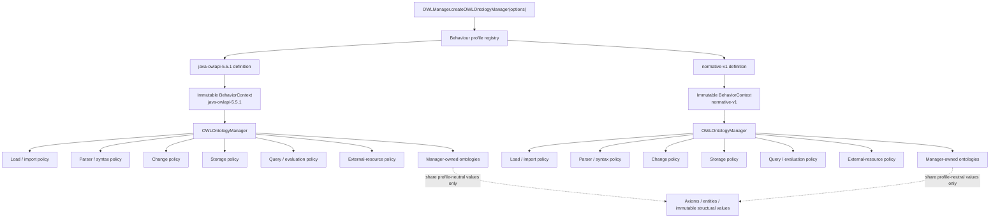
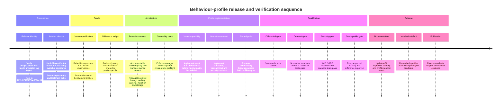

# Java-compatible API behaviour implementation plan

**File:** `docs/plans/2026-10-13-java-compatible-api-behavior-implementation-plan.md`\
**Date:** 2026-10-13\
**Status:** Replacement implementation plan\
**Profiles:** `java-owlapi-5.5.1`, `normative-v1`\
**Java oracle release:** OWLAPI 5.5.1\
**Java source commit:** `f760b3a4c107c6d5f90f856e5680c39b18af646f`\
**Java source tree:** `6b87391a36b7341f7253f57046b5b8621d3d0ac8`\
**Release tag:** `owlapi-parent-5.5.1`

This document supersedes the previous behavioural implementation plan.
Historical research, probes, baselines and completed implementation evidence remain evidence of what was observed at the time; they do not retain authority where this plan deliberately changes the target contract.

## Executive summary

The project will implement **one OWLAPI JavaScript codebase with two immutable, explicitly versioned behavioural profiles**:

| Profile             | Purpose                                           | Governing question                                                                                                    |
| ------------------- | ------------------------------------------------- | --------------------------------------------------------------------------------------------------------------------- |
| `java-owlapi-5.5.1` | Exact migration and behavioural-emulation profile | “What does the official Java OWLAPI 5.5.1 release actually do?”                                                       |
| `normative-v1`      | Standards- and contract-governed profile          | “What behaviour is required by applicable normative specifications and the project's formally adopted API contracts?” |

This replaces the previous premise that every observable Java quirk should become the single JavaScript behaviour.
The earlier implementation plan explicitly targeted Java-observed sequential change effects, retained manager/import state after failures, StringDocumentTarget accumulation and other quirks. The underlying research remains highly valuable, but those observations now become **profile inputs rather than universal requirements**. The existing evidence records, for example, Java-style thrown partial effects during change application, retained import/configuration state, StringDocumentTarget reuse behaviour, parser-fallback differences and lazy/live query behaviour. fileciteturn11file0L1-L19 fileciteturn12file0L1-L31 fileciteturn13file0L1-L39 fileciteturn15file0L1-L39 fileciteturn16file0L1-L13

The Java compatibility baseline is no longer an arbitrary source revision.
It is the formal OWLAPI **5.5.1 release**.
Maven Central publishes `net.sourceforge.owlapi:owlapi-distribution:5.5.1`; the upstream release commit is `f760b3a4c107c6d5f90f856e5680c39b18af646f`; the annotated tag `owlapi-parent-5.5.1` points through tag object `8003508e8c185579898ca4eda1245f808461d06a` to that exact commit.
The commit message is `OWLAPI version 5.5.1`, and the release commit changes the project from `5.5.1-SNAPSHOT` to `5.5.1`. citeturn13search12 fileciteturn8file0L1-L12 fileciteturn9file0L1-L12 fileciteturn6file0L1-L2

The profile architecture is **policy separation, not implementation duplication**.
A manager receives one immutable behavioural context at construction.
Loading, parsing, mutation, storage, security/resource handling and profile-sensitive utilities receive that context explicitly.
Model values remain profile-neutral wherever behaviour does not depend on a profile.
There is no global mode, no mutable profile switch, no “latest Java” alias and no arbitrary combination of independent compatibility flags.

The governing hierarchy for `normative-v1` is:

1. applicable **normative external specifications** and published errata;
2. explicit, versioned **project contracts**, including security and engineering guarantees adopted from referenceable principles;
3. Java OWLAPI 5.5.1 behaviour as the **compatibility fallback** where the first two levels do not prescribe a different observable result.

The hierarchy deliberately distinguishes a normative specification from any document colloquially called a “spec”.
OWL 2 Structural Specification and Functional-Style Syntax is a W3C Recommendation whose normative structural rules explicitly govern observable OWL-tool behaviour.
By contrast, OWL 2 Manchester Syntax is a W3C Working Group Note and expressly states that publication does not imply W3C endorsement. citeturn14search0turn14search2

That distinction corrects an important example discussed during design.
OWLAPI 5.5.1 maps the Manchester token `<=` to `xsd:maxInclusive`. fileciteturn25file0L1-L12 The Manchester Working Group Note's mapping table instead says `<=` maps to `xsd:minInclusive`. citeturn22view0 But the normative OWL 2 Structural Recommendation defines `xsd:minInclusive` as the lower-bound relation \(x \ge v\) and `xsd:maxInclusive` as the upper-bound relation \(x \le v\). citeturn14search0 Consequently **`normative-v1` must not blindly reproduce the Working Group Note's table merely because it is a W3C document**.
Under the hierarchy adopted here, the Recommendation outranks the non-endorsed Note; absent a deliberate contrary project contract, both profiles should retain `<= → xsd:maxInclusive`.
This example is the model for future authority resolution.

The implementation therefore has two complementary promises:

> **`java-owlapi-5.5.1` is an emulation contract. `normative-v1` is a conformance-and-contract contract.**

Neither is “the real implementation” with the other treated as a compatibility shim.
Both are first-class test subjects over the same shared implementation.

Release qualification requires three independent forms of proof: differential regression against the exact Java oracle for `java-owlapi-5.5.1`; specification, invariant and fault-injection testing for `normative-v1`; and cross-profile tests proving both deliberate differences and deliberate common behaviour.

## Scope and objectives

The implementation covers the selected Java-shaped public OWLAPI surface already represented by the repository's compatibility programme: manager construction and lifecycle, ontology loading and imports, parser selection, configuration, ontology changes, selected searches/providers/locality operations, profile evaluation and the currently exposed StringDocumentTarget storage routes.
The existing public factory already accepts an optional options object and constructs `OWLOntologyManager`, making behavioural-profile selection an extension of the existing API shape rather than a second public hierarchy. fileciteturn19file0L1-L10 The public documentation likewise describes the call as `OWLManager.createOWLOntologyManager(options?)`. fileciteturn18file11L147-L158

The replacement plan has the following objectives.

| Objective                              | Required outcome                                                                                                                                                                    |
| -------------------------------------- | ----------------------------------------------------------------------------------------------------------------------------------------------------------------------------------- |
| One implementation                     | Common model, parser infrastructure, indexes, renderers and transport abstractions; no forked “Java” and “normative” packages                                                       |
| Explicit behavioural contracts         | Every profile-sensitive observable is assigned to `java-owlapi-5.5.1`, `normative-v1`, or shared behaviour                                                                          |
| Formal Java provenance                 | Java oracle derives from the released OWLAPI 5.5.1 tag, published artefacts and locked effective dependency graph                                                                   |
| Immutable profile identity             | A manager's behavioural profile cannot change after construction                                                                                                                    |
| Standards discipline                   | “Normative” means normative specifications plus deliberately adopted contracts, not a generic preference for cleaner behaviour                                                      |
| Strong failure contracts where adopted | Operations designated transactional by `normative-v1` satisfy their stated commit-or-rollback invariant                                                                             |
| Secure external-resource handling      | `normative-v1` uses explicit policy for XML external resources and network dereferencing; Java compatibility reproduces Java behaviour within the declared host-capability boundary |
| Verifiable intentional divergence      | Every profile difference has a source, rationale, expected observable vector and paired test                                                                                        |
| Stable version semantics               | Existing profile identifiers never silently acquire new behaviour                                                                                                                   |
| Migration clarity                      | Consumers can choose exact Java emulation or the normative contract without learning hidden switches                                                                                |

**In scope.**
Structural and semantic output corrections are now governed by the same authority hierarchy rather than being categorically outside behavioural compatibility.
A Java/specification difference may therefore be intentionally split between profiles, but only after the specification's status, applicable normative clauses, errata and scope have been established.

**Out of scope.**
This plan does not require implementing every missing Java class or overload; ambient JVM facilities that have no JavaScript-host analogue; a second parser stack; a second ontology model; a global Java-emulation environment; arbitrary feature-flag combinations; or automatic compatibility with unreleased/future Java revisions.
Missing host capabilities must be reported as capability boundaries rather than silently approximated.

The old source pin `b61ebe2da83daceebb3e7ba7afbd2582c9240c33` is superseded for oracle qualification.
Existing probes produced against that revision may seed the new suite, but none constitutes final `java-owlapi-5.5.1` proof until rerun against the release artefacts.
The previous plan explicitly recorded the earlier arbitrary source pin, so this is a deliberate baseline change rather than a reinterpretation of existing evidence. fileciteturn2file0L1-L2

The nine previously evaluated divergence areas remain the minimum behavioural worklist.
The research already establishes concrete observations in those areas, including Java partial change effects, retained manager state, private JavaScript resource ceilings, StringDocumentTarget reuse, JSON-LD boundaries and lazy/live search behaviour. fileciteturn11file0L1-L19 fileciteturn12file0L1-L31 fileciteturn13file0L1-L39 fileciteturn14file0L1-L34 fileciteturn17file1L19-L28

Completion of this plan requires **zero unclassified observable divergences on the selected surface**.
“Unclassified” means that a difference cannot be traced to one of: shared behaviour, an exact Java-profile expectation, or an explicit `normative-v1` authority decision.

## Authority and profile contracts

The authority model is intentionally asymmetric: `normative-v1` resolves conflicts using a hierarchy; `java-owlapi-5.5.1` intentionally preserves the released Java implementation even where a higher-level specification would produce a different answer.
Otherwise the Java profile would cease to be a faithful migration oracle.

**Authority hierarchy for `normative-v1`.**

| Rank          | Authority                                       | What qualifies                                                                                                    | What does not qualify                                                                                           |
| ------------- | ----------------------------------------------- | ----------------------------------------------------------------------------------------------------------------- | --------------------------------------------------------------------------------------------------------------- |
| Highest       | External normative specification                | Applicable normative clauses of W3C Recommendations or equivalent standards, including published normative errata | Examples, informative prose, Working Group Notes merely because they are on `w3.org`, implementation traditions |
| Next          | Adopted project contract                        | A versioned, explicit, testable OWLAPI-JS requirement with cited rationale and defined observable guarantee       | “Best practice”, “idiomatic JavaScript”, performance preference, aesthetic simplification                       |
| Fallback      | Java OWLAPI 5.5.1                               | Behaviour of the exact published oracle where higher authorities leave the question open                          | Behaviour from another Java version, an unreleased branch, inferred “likely Java behaviour”                     |
| Evidence only | Existing JS implementation and historical plans | Evidence of migration impact, prior design and existing consumers                                                 | Independent authority to override the three ranks above                                                         |

The OWL 2 Structural Specification is particularly strong authority because it explicitly says its structural model provides the normative abstract representation for OWL 2 and is used to specify observable behaviour of OWL 2 tools, while permitting implementations to use different internal structures so long as observable behaviour conforms. citeturn14search0 This supports the architectural decision to share internal JavaScript mechanisms while varying only observable policy where required.

**Conflict-resolution procedure.**
Every proposed `normative-v1` difference must pass the following decision record before implementation:

| Field                     | Required decision                                                                                                                                              |
| ------------------------- | -------------------------------------------------------------------------------------------------------------------------------------------------------------- |
| Observable                | Define exactly what callers can distinguish: value, structure, accepted input, error category, failure phase, side effect, ordering, timing or external effect |
| External authority        | Identify the exact specification, status and applicable normative clause; check errata                                                                         |
| Contract authority        | If no external rule resolves it, identify the project contract and referenceable engineering/security rationale                                                |
| Java observation          | Record the exact 5.5.1 behaviour from independent oracle execution and, where useful, source inspection                                                        |
| Applicability             | Explain why the authority actually applies to this operation and not merely to a superficially similar problem                                                 |
| Guarantee                 | State preconditions, postconditions and failure guarantees in testable terms                                                                                   |
| Profile outcome           | `shared`, `java-only + normative-only`, or—in a genuinely one-sided extension—`java-only`/`normative-only`                                                     |
| Proof                     | Identify oracle, conformance, invariant, fault-injection and cross-profile tests                                                                               |
| Compatibility consequence | State migration impact and security consequence                                                                                                                |
| Decision status           | Proposed, accepted, superseded or rejected; never infer acceptance from implementation                                                                         |

If a normative external specification and an informative document disagree, the normative text wins.
If two applicable normative sources genuinely conflict, implementation must stop at the decision boundary until their scopes, revisions and errata are reconciled; arbitrary precedence by publication date is not permitted.
A non-normative source can influence `normative-v1` only after its relevant behaviour is deliberately adopted as a project contract.

Engineering principles therefore have **referenceable but bounded authority**.
The strong exception-safety guarantee is a useful model: it means an operation either completes or leaves the protected program state as it was before the operation—commit-or-rollback semantics.
Boost's canonical exception-safety exposition distinguishes this from the weaker basic guarantee, which preserves invariants but may permit state changes. citeturn16search0 The project may adopt the strong guarantee for an operation, but the mere existence of that principle does not imply every OWLAPI operation must provide it.

Similarly, ACID provides the historical transaction vocabulary, but OWLAPI JavaScript must not casually claim database-level ACID semantics.
Härder and Reuter's transaction/recovery work concerns transaction-oriented database systems.
Here, **atomicity** is relevant by analogy to operations explicitly defined as transactional; durability and database isolation do not automatically follow. citeturn17search0

Linearizability is narrower still.
Herlihy and Wing define it as a correctness condition for concurrent objects in which an operation appears to take effect at a point between invocation and response.
It should be applied only to stateful operations that can actually overlap or become observably interleaved—for example through asynchronous execution or re-entrancy—not as a decorative synonym for atomicity. citeturn15search0

Security authorities are also contractual inputs rather than OWL language semantics.
OWASP recommends disabling DTDs where possible and, where they are required, disabling external entity resolution/external DTD loading and limiting expansion; it identifies local-file disclosure, SSRF and resource exhaustion as XXE consequences. citeturn15search1 OWASP's SSRF guidance additionally calls for destination-policy validation at connection time rather than relying solely on superficial URL validation. citeturn15search4 NIST SP 800-218 SSDF 1.1 remains the current final SSDF publication as of this plan; NIST lists SP 800-218 Rev. 1 / SSDF 1.2 as a draft rather than a final replacement. citeturn23search0turn23search10 These sources justify a secure-development and external-resource contract but do not themselves prescribe OWLAPI method signatures.

**Profile definitions.**

`java-owlapi-5.5.1` means:

> The observable behaviour of the official OWLAPI 5.5.1 release, running with the dependency/runtime configuration recorded in its provenance manifest, reproduced on the selected JavaScript public surface including observable implementation quirks and specification deviations.

Its canonical name is exactly `java-owlapi-5.5.1`.
There is no `java-owlapi-latest`, `java-compatible`, `java5`, SHA-derived public alias or mutable pointer.
A later Java release receives a different immutable profile identifier.

`normative-v1` means:

> The observable behaviour required by the normative specification set and explicit project contracts frozen into normative contract version 1, falling back to `java-owlapi-5.5.1` where those authorities do not prescribe a different result.

Its canonical name is exactly `normative-v1`.
A behaviourally significant change to that contract requires `normative-v2`; a documentation clarification that leaves all observable requirements unchanged does not.

The distinction is deliberately not “correct” versus “incorrect”.
A Java-compatible result may faithfully emulate a historical implementation quirk and therefore be correct under its own contract.
Conversely, a `normative-v1` change must not be justified merely as “better”.

**Default policy.**
Public documentation and all new project code must select a profile explicitly.
For compatibility with the existing optional-options call shape, omitted `behaviorProfile` remains accepted in the first profile-aware release and resolves to `normative-v1`.
This makes the secure, specification/contract-governed profile the normal JavaScript behaviour while requiring Java quirks to be requested deliberately.
Changing that default later is itself a behavioural breaking change.
The current factory already supports an options object, so this choice does not require a parallel constructor family. fileciteturn19file0L1-L10

The manager must expose a read-only way to discover its resolved profile, preferably:

```js
manager.getBehaviorProfile();
// "normative-v1" or "java-owlapi-5.5.1"
```

There is no `setBehaviorProfile()`.

## Provenance and reproducibility

The Java profile is qualified against a **release artefact, source identity and complete dependency environment**, not merely a Git commit.

The upstream Git provenance is already sufficiently clear to freeze the source identity.
The Git reference `refs/tags/owlapi-parent-5.5.1` resolves to annotated tag object `8003508e8c185579898ca4eda1245f808461d06a`; that tag object targets commit `f760b3a4c107c6d5f90f856e5680c39b18af646f`. fileciteturn8file0L1-L12 fileciteturn9file0L1-L12 The target commit's tree is `6b87391a36b7341f7253f57046b5b8621d3d0ac8`, its message is `OWLAPI version 5.5.1`, and it records the 5.5.1 release changes. fileciteturn6file0L1-L2 Both the Git commit and annotated tag are reported by GitHub as unsigned, so the manifest must record that fact rather than describe this as signed Git provenance. fileciteturn6file0L1-L2 fileciteturn9file0L1-L12 Maven Central independently publishes the 5.5.1 distribution and related modules, providing a second release channel to bind into the oracle. citeturn13search12turn13search13turn13search17

The canonical provenance file shall be:

```text
docs/compatibility/profiles/java-owlapi-5.5.1/provenance.json
```

The resolved Java dependency lock shall be:

```text
docs/compatibility/profiles/java-owlapi-5.5.1/java-dependencies.lock.json
```

The manifest schema is fixed as follows.
Strings beginning `REQUIRED_` are deliberate qualification placeholders: they must be replaced by measured values before the profile can pass its provenance gate.

```json
{
  "schemaVersion": 1,
  "profileId": "java-owlapi-5.5.1",
  "qualifiedAt": "REQUIRED_UTC_TIMESTAMP",
  "upstream": {
    "repository": "owlcs/owlapi",
    "releaseVersion": "5.5.1",
    "tag": {
      "name": "owlapi-parent-5.5.1",
      "objectType": "tag",
      "objectSha": "8003508e8c185579898ca4eda1245f808461d06a",
      "peeledCommitSha": "f760b3a4c107c6d5f90f856e5680c39b18af646f",
      "taggerTimestamp": "2024-09-08T13:30:53Z",
      "gitSignatureVerified": false
    },
    "commit": {
      "sha": "f760b3a4c107c6d5f90f856e5680c39b18af646f",
      "treeSha": "6b87391a36b7341f7253f57046b5b8621d3d0ac8",
      "message": "OWLAPI version 5.5.1",
      "commitTimestamp": "2024-09-07T20:46:24Z",
      "gitSignatureVerified": false
    }
  },
  "mavenCentral": {
    "primaryCoordinate": {
      "groupId": "net.sourceforge.owlapi",
      "artifactId": "owlapi-distribution",
      "version": "5.5.1"
    },
    "artefacts": [
      {
        "groupId": "net.sourceforge.owlapi",
        "artifactId": "owlapi-distribution",
        "version": "5.5.1",
        "type": "pom",
        "classifier": null,
        "bytes": "REQUIRED_INTEGER",
        "sha256": "REQUIRED_64_HEX",
        "signature": {
          "present": "REQUIRED_BOOLEAN",
          "verified": "REQUIRED_BOOLEAN",
          "keyFingerprint": "REQUIRED_IF_VERIFIED"
        }
      },
      {
        "groupId": "net.sourceforge.owlapi",
        "artifactId": "owlapi-distribution",
        "version": "5.5.1",
        "type": "jar",
        "classifier": null,
        "bytes": "REQUIRED_INTEGER",
        "sha256": "REQUIRED_64_HEX",
        "signature": {
          "present": "REQUIRED_BOOLEAN",
          "verified": "REQUIRED_BOOLEAN",
          "keyFingerprint": "REQUIRED_IF_VERIFIED"
        }
      }
    ],
    "dependencyLock": {
      "path": "java-dependencies.lock.json",
      "sha256": "REQUIRED_64_HEX",
      "resolvedRepository": "Maven Central",
      "containsRuntimeClosure": true,
      "containsBuildClosure": true
    }
  },
  "toolchain": {
    "jdk": {
      "distribution": "REQUIRED_DISTRIBUTION",
      "version": "REQUIRED_EXACT_VERSION",
      "distributionSha256": "REQUIRED_IF_ARCHIVED_LOCALLY"
    },
    "maven": {
      "version": "REQUIRED_EXACT_VERSION",
      "distributionSha256": "REQUIRED_64_HEX"
    },
    "os": "REQUIRED_QUALIFICATION_OS"
  },
  "sourceBuild": {
    "sourceCommit": "f760b3a4c107c6d5f90f856e5680c39b18af646f",
    "cleanCheckoutRequired": true,
    "command": "REQUIRED_EXACT_COMMAND",
    "networkModeAfterDependencySeed": "offline",
    "artefactComparison": {
      "centralJarSha256": "REQUIRED_64_HEX",
      "rebuiltJarSha256": "REQUIRED_64_HEX",
      "byteIdentical": "REQUIRED_BOOLEAN",
      "nonIdentityReason": "REQUIRED_IF_FALSE"
    }
  },
  "oracle": {
    "harnessSourceCommit": "REQUIRED_OWLAPI_JS_COMMIT",
    "fixturesManifestSha256": "REQUIRED_64_HEX",
    "observationManifestSha256": "REQUIRED_64_HEX",
    "javaCommand": "REQUIRED_EXACT_COMMAND",
    "classpathLockSha256": "REQUIRED_64_HEX"
  }
}
```

The dependency lock must contain every artefact that can affect oracle execution or source reconstruction.
Maven's official Dependency Plugin can output the dependency tree in JSON and describes that tree as the hierarchy actually resolved by Maven; this is the appropriate starting point, but the project's lock adds byte-level SHA-256 verification because coordinates alone do not prove which bytes were executed. citeturn13search0turn13search1

Each lock entry shall have at least:

```json
{
  "groupId": "org.example",
  "artifactId": "example",
  "version": "1.2.3",
  "type": "jar",
  "classifier": null,
  "scope": "runtime",
  "optional": false,
  "sha256": "64_HEX_DIGEST",
  "bytes": 12345,
  "repository": "Maven Central"
}
```

Separate `runtime` and `build` closures are required.
A source build can be affected by Maven plugins and plugin dependencies even when they are not on the application's runtime classpath.

**Provenance verification procedure.**

| Gate               | Required verification                                                                                                                                |
| ------------------ | ---------------------------------------------------------------------------------------------------------------------------------------------------- |
| Tag identity       | Fetch exact `owlapi-parent-5.5.1` ref; assert type `tag`; record tag-object SHA                                                                      |
| Tag peel           | Dereference annotated tag; assert target commit equals `f760b3a4…`                                                                                   |
| Commit identity    | Assert commit tree equals `6b87391…`, release message/version and clean checkout                                                                     |
| Release source     | Assert parent/module versions at that commit identify `5.5.1`, not `5.5.1-SNAPSHOT`                                                                  |
| Maven publication  | Resolve `net.sourceforge.owlapi:owlapi-distribution:5.5.1` from Maven Central only                                                                   |
| Artefact integrity | Download POM/JAR and associated signatures/checksums where provided; compute project-owned SHA-256 values independently                              |
| Dependency lock    | Resolve complete effective dependency graph with a pinned Maven version; hash every resolved POM/JAR/plugin artefact                                 |
| Clean replay       | Purge or isolate the local Maven repository; resolve only the locked set; fail on unexpected additional resolution                                   |
| Source build       | Build unmodified commit with pinned JDK/Maven; record exact outputs and compare with Central                                                         |
| Oracle proof       | Run the Java behavioural harness against the Central artefact/classpath and separately against the source build; investigate any semantic difference |
| Freeze             | Commit manifest, dependency lock, oracle observations and their digests before using the profile as release evidence                                 |

Maven defines a reproducible build as one that can recreate bit-for-bit identical artefacts from the same source, environment and build instructions, and documents `project.build.outputTimestamp` and reproducible plugin configuration as enabling mechanisms. citeturn13search15 Because this project is verifying an already-published upstream release, it must **not modify OWLAPI 5.5.1 source merely to make it reproducible**.
If an unmodified 5.5.1 source build is not byte-identical to Central, the manifest records that fact.
The Central bytes remain the executable compatibility oracle; the source build then provides corroborating source/probe evidence rather than a fabricated claim of bit-reproducibility.

A release cannot claim `java-owlapi-5.5.1` qualification while any `REQUIRED_*` provenance field remains unresolved.

## Behavioural architecture

The behavioural profile is owned by the ontology manager and represented internally by an immutable `BehaviorContext`.
The context resolves a coherent set of policies at construction rather than scattering checks such as `if (profile === "java")` throughout parsing, loading and model code.



The public call shape is:

```js
const normativeManager = OWLManager.createOWLOntologyManager({
  behaviorProfile: "normative-v1",
});

const javaManager = OWLManager.createOWLOntologyManager({
  behaviorProfile: "java-owlapi-5.5.1",
});
```

Existing calls remain valid:

```js
const manager = OWLManager.createOWLOntologyManager();

// Defined alias in the first profile-aware release:
manager.getBehaviorProfile() === "normative-v1";
```

The current factory already forwards an optional options object to `OWLOntologyManager`, so the implementation should extend that configuration path instead of adding `JavaOWLManager`, `NormativeOWLManager`, duplicate packages or profile-specific public class trees. fileciteturn19file0L1-L10

**Internal context shape.**
The precise private representation may evolve without changing the profile contract, but it should have equivalent semantics to:

```js
{
  profileId: "normative-v1",
  contractVersion: 1,
  provenanceDigest: "...",
  mutationPolicy: ...,
  loadingPolicy: ...,
  parserPolicy: ...,
  storagePolicy: ...,
  resourcePolicy: ...,
  externalResourcePolicy: ...,
  evaluationPolicy: ...
}
```

The resolved context and its policy objects must be immutable.
A profile registry is likewise immutable after module initialisation.
Consumers cannot supply individual internal strategies and thereby construct undeclared hybrid profiles.

**Propagation rules.**

| Component                                              | Rule                                                                                                                                     |
| ------------------------------------------------------ | ---------------------------------------------------------------------------------------------------------------------------------------- |
| Manager                                                | Primary owner of the immutable `BehaviorContext`                                                                                         |
| Managed ontology                                       | Bound privately to its owning manager/context for profile-sensitive operations                                                           |
| Axioms, entities, literals and other structural values | Profile-neutral unless an external specification truly defines different structure at construction                                       |
| Loader/import session                                  | Captures the manager context at operation start and retains that exact context until completion                                          |
| Parser                                                 | Receives an operation context; does not query a global profile                                                                           |
| Storer/renderer                                        | Receives the initiating manager context                                                                                                  |
| Search/provider/locality operation                     | Receives or closes over the manager context needed to define lazy/live behaviour                                                         |
| Data factory                                           | Manager-owned factories inherit the manager context where construction semantics can differ; profile-neutral construction remains shared |
| Standalone profile-sensitive utility                   | Must receive an explicit context/profile through its public construction boundary; no ambient lookup                                     |
| Asynchronous continuation                              | Retains its initiating context; later global/default changes cannot alter it                                                             |
| Error normalisation                                    | Uses the active profile's contract without mutating context or leaking another profile's semantics                                       |

**Ontology ownership and transfer.**
A managed ontology belongs to exactly one manager for lifecycle and mutation semantics.
It cannot be silently re-parented to a second manager, because that would change the behavioural contract governing the same mutable object.

Where a supported API operation conceptually moves or copies an ontology between managers, it must use these semantics:

1. obtain a profile-neutral structural snapshot from the source ontology;
2. preflight destination identity/import/index conflicts under the destination manager's context;
3. validate any destination-profile structural requirements;
4. create a **new destination-managed ontology instance**;
5. publish that instance according to the destination manager's failure contract;
6. leave the source manager and source ontology unchanged.

A failed transfer must not leave an ontology half-owned by either manager.
A destination identity collision must fail before publication.
The source object's manager binding never changes.

Immutable structural values may be shared across profile contexts when their meaning is identical.
Sharing an axiom object does not transfer ontology ownership.

**Cross-profile operation rules.**

| Situation                                                                        | Required behaviour                                                                                                                         |
| -------------------------------------------------------------------------------- | ------------------------------------------------------------------------------------------------------------------------------------------ |
| Mutation requested through non-owning manager                                    | Reject before mutation                                                                                                                     |
| One managed ontology passed to another manager for storage                       | The initiating/destination manager profile governs only where the API explicitly supports such a target; otherwise reject ownership misuse |
| Composite operation consumes multiple managed ontologies from different profiles | Require an explicit destination manager and snapshot/copy semantics, or reject before effects                                              |
| Profile-neutral equality/hash comparison                                         | Shared implementation; profile identity does not affect result                                                                             |
| Profile-sensitive serialisation/parsing                                          | Initiating manager/context governs                                                                                                         |
| Lazy result created under one context and consumed later                         | Original context remains authoritative                                                                                                     |
| Context mismatch inside internal call graph                                      | Programming error; fail fast rather than selecting one profile implicitly                                                                  |
| Future API needs mixed-profile semantics                                         | Requires a new explicit contract; it cannot infer “stricter wins”, “Java wins” or “normative wins”                                         |

Where concurrent or re-entrant manager writes can overlap, a `normative-v1` atomic operation must have a defined publication/linearisation point or the implementation must reject overlapping writes.
Linearizability is relevant only where operations can be observably concurrent; it is not required for pure immutable computations. citeturn15search0

The implementation shall concentrate differences in policy/transaction boundaries.
Duplicated algorithms, profile-specific copies of parsers and pervasive profile conditionals are architectural failures even if tests pass.

## Divergence implementation and verification

The original behavioural investigation remains the starting inventory, but profile outcomes change.
Existing research specifically identified Java partial batch effects, import/configuration retention, private JavaScript resource ceilings, XML/JSON-LD limits, parser fallback behaviour, target accumulation and deferred/live search semantics. fileciteturn11file0L1-L19 fileciteturn12file0L1-L31 fileciteturn13file0L1-L39 fileciteturn14file0L1-L34 fileciteturn15file0L1-L39 fileciteturn16file0L1-L13

In the table, **Shared** means the same observable contract is deliberately adopted by both profiles.
**Java-only + normative-only** means the divergence is intentional and both sides require independent expected results.
A common internal mechanism can still serve a split row.

| Evaluated divergence                        | `java-owlapi-5.5.1`                                                                                                    | `normative-v1`                                                                                                                                                                                     | Outcome                                                                  | Required tests                                                                                                                | Acceptance criterion                                                                                                                                                                          |
| ------------------------------------------- | ---------------------------------------------------------------------------------------------------------------------- | -------------------------------------------------------------------------------------------------------------------------------------------------------------------------------------------------- | ------------------------------------------------------------------------ | ----------------------------------------------------------------------------------------------------------------------------- | --------------------------------------------------------------------------------------------------------------------------------------------------------------------------------------------- |
| Failed change batches                       | Reproduce 5.5.1 sequential effects, return classifications, thrown partial effects and rollback quirks exactly         | Batch mutation is an atomic unit: preflight what is knowable, stage changes/index updates, publish once; failure before publication restores all manager/ontology observable state                 | Java-only + normative-only                                               | Java differential probe; fault at every mutation stage; index/import/annotation/ID state snapshots; paired profile test       | Java vector exactly equals oracle. Normative failure leaves ontology contents, ID indexes, metadata and change-visible state observationally equivalent to pre-call state                     |
| Failed ontology/import loading              | Reproduce Java retention of imports, import-request markers, ID-keyed configuration and other measured manager effects | Stage state created solely by the load session and publish only when the root operation satisfies its configured missing-import policy; pre-existing manager state is untouched                    | Java-only + normative-only                                               | Root parse failure; nested import failure; duplicate IDs; retry; rename/remove/reload; every publication fault point          | Java matches 5.5.1. Normative failed root load publishes no new root/import/index/config state from that transaction; a configured “missing import tolerated” result is success, not rollback |
| Save failure and StringDocumentTarget reuse | Reproduce Java 5.5.1 accumulation/reuse and measured failure effects                                                   | Current in-memory StringDocumentTarget save is transactional replacement: render into private buffer, commit only on success; failed save leaves prior target value unchanged                      | Java-only + normative-only                                               | Save twice; injected renderer failures before/after bytes are produced; all supported formats                                 | Java target bytes match oracle. Normative success replaces target once; failure preserves exact pre-call target content                                                                       |
| Private resource limits                     | Reproduce actual Java/Rio/provider limits where observable; remove JS-only limits not present in oracle                | No hidden semantic-validity caps. Security/resource budgets are named, documented, typed and configurable; defaults must be justified by threat model and qualification data                       | Java-only + normative-only, with shared “no undocumented caps” invariant | Boundary tests below/at/above every limit; large valid structures; exhaustion classification                                  | Every finite rejection names its resource and configured/Java authority. No private unexplained depth/annotation/work/byte cap affects results                                                |
| XML entity processing                       | Match 5.5.1's qualified XML-provider behaviour within available host capabilities                                      | External entity resolution and external DTD loading disabled for untrusted/default parsing; unsupported hardening fails closed; entity expansion bounded where DTD support is deliberately enabled | Java-only + normative-only                                               | Local-file XXE, HTTP XXE, recursive entity expansion, malformed XML, parser-security-setting failure                          | Java oracle match. Normative default produces no external file/network access and no unbounded entity expansion                                                                               |
| Remote imports and JSON-LD contexts         | Match 5.5.1 attempts, redirects, caching, whitelist/settings and effective provider boundaries                         | Remote dereference disabled unless an explicit manager access policy authorises it; policy covers schemes, destinations, redirects, credentials, retries, byte/time budgets and cache behaviour    | Java-only + normative-only                                               | Owned HTTP server; redirects; private/loopback destinations; retry/cache; context chains; credential redirect tests           | Java network event vector matches oracle. Normative performs no undeclared external request and rejects/permits every request according to one inspectable policy                             |
| Parser fallback and error reporting         | Match Java factory/candidate order, mismatch/fallback behaviour and failure phase                                      | Deterministic evidence-based candidate resolution; fallback only after an explicitly classified parser mismatch; genuine malformed-input errors retain their diagnostic cause                      | Java-only + normative-only                                               | 9,000-space Functional fixture and controls; ambiguous extensions/media types; malformed high-confidence syntax; error chains | Java exactly reproduces oracle. Normative never converts a real syntax/security/resource failure into an unrelated successful fallback                                                        |
| Configuration semantics                     | Preserve 5.5.1 defaults, copy/reset/no-op/negative-value quirks and timing where observable                            | Canonical documented value domain and defaults; invalid values fail at documented boundary; configuration ownership is explicit and no ambient JVM/System-property substitute is invented          | Java-only + normative-only                                               | Getter/setter/copy/no-op identity matrix; invalid values; operation-start versus consumption-time reads                       | Java matrix equals 5.5.1. Normative configuration has one documented source of truth and no hidden ambient override                                                                           |
| Lazy search and callback timing             | Preserve measured Java eager/lazy/live and callback-consumption semantics                                              | Adopt the same semantics in `normative-v1` because no higher authority currently requires a different contract                                                                                     | Shared                                                                   | Creation/consume mutation probes; callback count/order; empty-seed locality; live closure changes                             | Both profiles pass the same expected vectors; no profile branch exists for behaviour currently classified shared                                                                              |

The resource-ceiling research is particularly important: the dossier identifies private resource ceilings as breaking closure of the public object API. fileciteturn17file1L19-L28 `normative-v1` does **not** solve that by pretending resources are infinite.
It replaces invisible semantic constraints with explicit resource policy.
Security limits and ontology-language validity are different concepts and must have different errors.

The XML and network policies derive from concrete secure-processing risks.
OWASP identifies XXE as capable of local-file disclosure, SSRF and resource exhaustion and recommends disabling external entities/external DTD loading when DTDs are needed. citeturn15search1 OWASP SSRF guidance requires validating the actual destination, including resolved addresses, rather than assuming a syntactically acceptable domain is safe. citeturn15search4 `normative-v1` therefore treats transport permission as an explicit capability, while `java-owlapi-5.5.1` remains an emulation profile and must be documented as unsuitable for untrusted input where Java-compatible external-resource behaviour increases risk.

**Security and resource-policy contract.**

`normative-v1` must define one manager-owned external-resource policy containing, at minimum: allowed schemes; remote-access enablement; destination/host/IP rules; redirect policy; credential-forwarding policy; request and aggregate byte ceilings; timeout semantics; import/context traversal bounds; and cache lifetime/ownership.
Values must be public configuration or documented constants, never magic numbers in individual parsers.

No production parser may silently continue after a requested security control could not be established.
This follows OWASP's fail-closed guidance for unsupported XML-security settings. citeturn15search1 Secure-development review and provenance controls shall follow the current final NIST SSDF 1.1 baseline; the draft SSDF 1.2 can inform review but does not become governing authority until finalised and deliberately adopted.
NIST still lists 1.2 as draft as of October 2026. citeturn23search10

**Exception and transaction guarantees.**

For `normative-v1`, the following operations are explicitly assigned the strong exception guarantee over their stated in-memory boundary:

| Operation                            | Protected state                                                            |
| ------------------------------------ | -------------------------------------------------------------------------- |
| Batch ontology change                | Managed ontology state plus manager indexes/metadata modified by the batch |
| Root ontology load                   | Manager state newly staged by that load session                            |
| Cross-manager ontology copy/adoption | Destination manager publication state                                      |
| StringDocumentTarget save            | Existing in-memory target contents                                         |

The strong exception guarantee has an established meaning of successful completion or no change to protected program state. citeturn16search0 It is therefore a suitable reference for these contracts.
It is **not** automatically assigned to future network streams, file descriptors or caller-owned writers where external side effects may be inherently irreversible; those APIs must document their own basic/strong guarantee when introduced.

ACID terminology may be used internally to reason about atomic commit and consistency of staged manager state, but public documentation must not claim full ACID transactions unless isolation and durability are actually specified and proven.
Härder and Reuter's transaction framework is database-oriented and broader than these in-memory API guarantees. citeturn17search0

**Test architecture.**

Java-profile verification must be differential.
The independent Java harness runs against the Maven-Central-qualified 5.5.1 classpath and records an ordered observable vector including, as applicable:

`accepted/rejected → result/value → exception class/category → failure phase → ontology contents → manager indexes → imports/markers/configuration → callback count/order → deferred-consumption result → target bytes → network attempts`.

Expected Java observations may never be generated by the JavaScript implementation itself.
The old probes can be reused structurally, but their expectations must be regenerated against the newly frozen 5.5.1 oracle.

Normative-profile verification is contract-based, not Java-derived.
Each normative row must have precondition, success postcondition, failure postcondition and invariants.
Fault injection must force every meaningful failure point in staged operations.
Standards-sensitive parsing/structural behaviours must use official W3C tests where applicable; the repository already has a separate plan for exact-package, pinned-suite W3C conformance reporting and explicitly treats conformance evidence as version-specific. fileciteturn23file0L1-L2

Cross-profile verification is mandatory even where each profile passes independently.
Every classified difference must have a paired test proving that:

```text
same input
+ same host capabilities
+ different profile
= exactly the documented expected difference
```

Every `shared` row must have a paired test proving equality and, where practical, asserting that both profiles execute the same policy implementation.

The release matrix is therefore:

| Test layer                   | Java profile                        | Normative profile                  | Cross-profile                           |
| ---------------------------- | ----------------------------------- | ---------------------------------- | --------------------------------------- |
| Public API shape             | Required                            | Required                           | Required                                |
| Black-box Java oracle        | Primary                             | Informative only                   | Used to identify intentional difference |
| W3C conformance              | Diagnostic where Java differs       | Primary where normative            | Expected-difference check               |
| Contract/invariant tests     | Java-observed contract              | Primary                            | Required                                |
| Fault injection              | Match Java consequence              | Strong/basic guarantee as declared | Required on split rows                  |
| Security adversarial tests   | Characterise compatibility exposure | Primary release gate               | Verify separation                       |
| Node/browser qualification   | Required where capability exists    | Required                           | Required                                |
| Lazy/re-entrant timing tests | Required                            | Required                           | Required                                |
| Installed-package tests      | Required                            | Required                           | Required                                |

Release acceptance requires all of the following simultaneously: zero unknown Java-profile differences on the selected surface; zero unresolved normative contract failures; zero unclassified cross-profile differences; zero profile-context leaks; complete provenance; and documentation matching the shipped profile matrix.

## Release lifecycle, migration and references

Profile semantics and package semantics are versioned independently.

Semantic Versioning requires a declared public API, prohibits modifying the contents of an already released version, and treats incompatible public-API changes as major-version changes once the package is at or beyond 1.0.0; it also explicitly treats 0.y.z as initial development. citeturn21search0 The project should follow the same immutability principle for profile contracts even while package versioning remains pre-1.0.

**Java-profile lifecycle.**

| Event                                      | Rule                                                                                                    |
| ------------------------------------------ | ------------------------------------------------------------------------------------------------------- |
| Upstream patch/minor/major release appears | No existing profile changes                                                                             |
| Candidate new Java profile                 | Must correspond to a formal published OWLAPI release, not merely a branch or release-preparation commit |
| Intake                                     | Verify release tag, peeled commit, Maven Central publication and artefact signatures/digests            |
| Qualification                              | Lock dependencies/toolchain; run full Java oracle; compare against prior supported Java profile         |
| Classification                             | Every changed observable receives an authority/profile decision                                         |
| Admission                                  | Add `java-owlapi-X.Y.Z` only after implementation and full qualification                                |
| Old profile                                | Retains its exact semantics indefinitely while supported                                                |
| Security defect in Java behaviour          | Document prominently; do not silently “fix” the Java profile and continue claiming equivalence          |
| Retirement                                 | Profile may move to archived/unsupported status, but its documented identity is never retargeted        |

There is never a `java-owlapi-latest` contract.
“Latest” is inherently mutable and therefore incompatible with reproducible behavioural emulation.

**Normative-profile lifecycle.**

| Change                                                                           | Treatment                                                                                                             |
| -------------------------------------------------------------------------------- | --------------------------------------------------------------------------------------------------------------------- |
| Typographical/documentation clarification with no observable change              | Keep `normative-v1`                                                                                                   |
| Additional tests proving an existing v1 rule                                     | Keep `normative-v1`                                                                                                   |
| Bug fix that makes implementation comply with an already-existing v1 requirement | Keep `normative-v1`; package version changes normally                                                                 |
| New external Recommendation that would change observable behaviour               | Analyse and explicitly adopt into `normative-v2`; never mutate v1 silently                                            |
| Newly discovered conflict in existing authorities                                | Record decision; if resolution changes the frozen v1 contract, create v2                                              |
| Changed security default that affects observable behaviour                       | New normative profile version unless the old behaviour was already non-conforming to a frozen v1 security requirement |
| Addition of a purely new capability outside existing contract                    | Package-compatible addition where appropriate; assign its profile contract explicitly                                 |
| “Better” behaviour with no higher authority                                      | Retain v1 behaviour; candidate change belongs in a future contract proposal                                           |

The package release must publish a support matrix such as:

| Profile             | Status                          | Oracle/contract                  | Intended user                                                       |
| ------------------- | ------------------------------- | -------------------------------- | ------------------------------------------------------------------- |
| `normative-v1`      | Supported, recommended          | Normative contract v1            | New JavaScript applications; security/standards-sensitive consumers |
| `java-owlapi-5.5.1` | Supported compatibility profile | OWLAPI 5.5.1 provenance manifest | Java migrations requiring behavioural equivalence                   |

**Migration plan.**

Public README/API examples must always show explicit profile selection even though omitted `behaviorProfile` remains a supported alias for `normative-v1`.
Existing examples currently create managers without options, so they must be updated to make contract selection visible. fileciteturn18file1L18-L27

The documentation set must contain one canonical profile document:

```text
docs/compatibility/behavior-profiles.md
```

It must define the authority hierarchy, profile identities, default, security warning for Java compatibility, immutable versioning rules, cross-profile ownership rules and links to each profile's manifest/contract ledger.

The compatibility research dossier remains historical/technical evidence.
Its README already treats the research reports and evidence snapshots as inputs to this implementation plan; that relationship should be retained while making clear that the new plan classifies observations per profile. fileciteturn1file0L1-L10

The following owning documents must be reconciled rather than duplicated: `README.md`, `API.md`, default-behaviour inventory, Java parity/decision ledgers, W3C conformance documentation, migration guide, native contract fixtures and the Java reference-harness documentation.
Historical release records must not be rewritten to pretend the two-profile architecture existed previously.

Every intentional difference should have a machine-readable ledger record equivalent to:

```json
{
  "id": "BEHAVIOR-MUTATION-FAILED-BATCH",
  "surface": "OWLOntologyManager.applyChanges",
  "classification": "profile-divergence",
  "javaProfile": {
    "profile": "java-owlapi-5.5.1",
    "expectation": "oracle:java-5.5.1:mutation-failed-batch"
  },
  "normativeProfile": {
    "profile": "normative-v1",
    "expectation": "contract:strong-exception-guarantee"
  },
  "authority": [
    "project-contract:normative-v1:atomic-batch-mutation",
    "reference:exception-safety-strong-guarantee"
  ],
  "tests": [
    "java-oracle/mutation-failed-batch",
    "normative/mutation-atomicity-fault-injection",
    "cross-profile/mutation-failed-batch"
  ]
}
```

This ledger replaces broad labels such as “intentional standards difference” with an auditable decision per observable.

**Release and verification sequence.**
The sequence is gate-driven rather than date-estimated: no later stage starts merely because time has elapsed.



**Key references.**

| Reference                                                                                                                          | Role in this plan                                                                             |
| ---------------------------------------------------------------------------------------------------------------------------------- | --------------------------------------------------------------------------------------------- |
| OWLAPI `owlapi-parent-5.5.1` annotated release tag and `f760b3a4…` commit fileciteturn9file0L1-L12 fileciteturn6file0L1-L2 | Exact Java source provenance                                                                  |
| Maven Central `net.sourceforge.owlapi:owlapi-distribution:5.5.1` citeturn13search12                                             | Canonical published executable oracle                                                         |
| W3C OWL 2 Structural Specification and Functional-Style Syntax, Second Edition citeturn14search0                                | Primary OWL structural normative authority                                                    |
| W3C OWL 2 Manchester Syntax, Second Edition, Working Group Note citeturn14search2turn22view0                                   | Informative/adoptable syntax authority whose status must not be mistaken for a Recommendation |
| OWLAPI 5.5.1 `OWLFacet` source fileciteturn25file0L1-L12                                                                       | Exact Java facet-symbol behaviour                                                             |
| OWASP XML External Entity Prevention Cheat Sheet citeturn15search1                                                              | XML external-resource security contract                                                       |
| OWASP SSRF Prevention Cheat Sheet citeturn15search4                                                                             | Network destination/redirect policy rationale                                                 |
| NIST SP 800-218 SSDF 1.1 citeturn23search0                                                                                      | Current final secure-development framework                                                    |
| Apache Maven reproducible-build guidance citeturn13search15                                                                     | Reproducible-build qualification                                                              |
| Apache Maven Dependency Plugin documentation citeturn13search0turn13search1                                                    | Resolved-dependency inventory                                                                 |
| David Abrahams, exception-safety guarantees citeturn16search0                                                                   | Basic versus strong exception guarantee                                                       |
| Härder and Reuter, transaction-oriented recovery citeturn17search0                                                              | Transaction/atomicity vocabulary, used with limited scope                                     |
| Herlihy and Wing, linearizability citeturn15search0                                                                             | Correctness model for genuinely overlapping stateful operations                               |
| Semantic Versioning 2.0.0 citeturn21search0                                                                                     | Public-package version/change discipline                                                      |

**Prioritised implementation gates.**

| Priority | Work                                                                              | Exit condition                                                                                                                      |
| -------- | --------------------------------------------------------------------------------- | ----------------------------------------------------------------------------------------------------------------------------------- |
| P0       | Replace the old Java source pin with the formal 5.5.1 release provenance          | Tag, tag object, commit, tree, Central POM/JAR SHA-256, dependency lock and toolchain manifest all frozen                           |
| P0       | Re-run the complete Java research/oracle suite against the 5.5.1 Central artefact | Existing findings either reconfirmed or explicitly revised; no old-pin assumption remains silently authoritative                    |
| P0       | Establish authority/expected-difference ledger                                    | Every known divergence, including structural corrections, has status, authority and profile outcome                                 |
| P0       | Implement immutable `BehaviorContext` and manager ownership                       | No global/mutable profile state; profile identity survives every async/internal path                                                |
| P1       | Implement mutation and loading transaction boundaries                             | Java partial-state behaviour passes oracle; normative strong-guarantee fault injection passes                                       |
| P1       | Implement storage transaction policy                                              | StringDocumentTarget Java reuse and normative replacement/rollback both proven                                                      |
| P1       | Consolidate XML, remote-import, JSON-LD and resource policy                       | Java compatibility and normative secure defaults each pass adversarial tests                                                        |
| P1       | Rework parser fallback/configuration through policy boundaries                    | No duplicated parser stacks; all Java/normative differences explicitly tested                                                       |
| P2       | Prove shared lazy/search semantics and remove unnecessary profile branches        | Shared tests pass both profiles with identical observable vectors                                                                   |
| P2       | Qualify exact installed package in Node and supported browser lanes               | Both profiles pass from packaged bytes, not source-tree imports                                                                     |
| P2       | Complete migration, security and support documentation                            | A developer can select either profile and understand guarantees, risks and version identity without consulting implementation code  |
| Release  | Freeze evidence and publish only after all profile gates pass                     | Zero unknown Java differences, zero normative contract violations, zero unclassified cross-profile differences, complete provenance |

The resulting architecture preserves the strongest reason for Java compatibility—**a genuinely faithful migration target**—without making Java implementation accidents the permanent design authority for all JavaScript users.
At the same time, `normative-v1` is constrained enough to avoid becoming a subjective “better behaviour” mode: every departure from Java must be grounded in an applicable normative source or an explicit, versioned and independently testable project contract.
